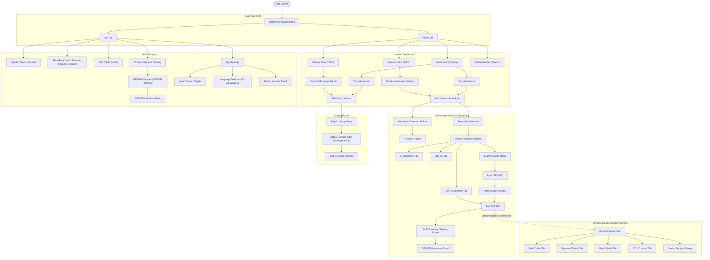

# Android UI Map: BanlanX Application (v3.3.5)

## 1. Overview & Architecture
This document maps the complete screen hierarchy, UI workflows, navigation transitions, and widget specifications of the official **BanlanX** Android application (`com.spled.scenex` v3.3.5). Findings are synthesized from live automated ADB UIAutomator tree inspections on `emulator-5554`, captured screenshots in `research/screenshots/`, and asset declarations within `research/decompiled/apktool/assets/flutter_assets/`.

BanlanX is built on Flutter v2/v3 using a unified reactive navigation shell (`com.spled.scenex.MainActivity`). Device control interfaces share the universal multi-model controller package `packages/sp630e/` across the SP530E (model `0x4E`) and SP630E (model `0x48`).

---

## 2. Global Navigation Flowchart

---

## 3. Screen Inventory & Widget Specifications

### 3.1 Home / Dashboard Screen (`01_home_screen.png`)
* **Route**: Root shell (`/`)
* **XML Dump**: `research/screenshots/01_home.xml`
* **Layout Structure**:
  * **Top Profile Header**:
    * Avatar + Username: `android.widget.ImageView` at `[37,163][894,268]`, content-desc `"Guest"`. Tapping opens account login.
    * Quick Actions (+): `android.widget.ImageView` at `[932,153][1080,279]`. Tapping reveals popup menu (`02_top_right.xml`).
  * **View Category Segmented Control**:
    * Devices Tab: `android.view.View` at `[37,697][263,768]`, content-desc `"Devices\nTab 1 of 2"`.
    * Groups Tab: `android.view.View` at `[263,697][475,768]`, content-desc `"Groups\nTab 2 of 2"`.
    * Layout Toggle / Filter: Clickable icons at `[825,696][928,769]` (view mode list/grid) and `[931,696][1035,769]`.
  * **Empty State Body**:
    * Vector Artwork: `android.widget.ImageView` at `[278,1105][803,1453]`.
    * Status Label: `android.view.View` at `[430,1466][650,1534]`, content-desc `"No devices"`.
    * Primary CTA: `android.widget.Button` at `[373,1600][707,1724]`, content-desc `"Add device"`.
  * **Bottom Navigation Bar**:
    * Home Tab: `android.widget.Button` at `[0,2256][540,2424]`, content-desc `"Home"`.
    * Me Tab: `android.widget.ImageView` at `[540,2256][1080,2424]`, content-desc `"Me"`.

---

### 3.2 Quick Add Popup Menu (`22_home_top_right.png`)
* **Trigger**: Tapping `[932,153][1080,279]` on Home Screen.
* **XML Dump**: `research/screenshots/22_top_right.xml`
* **Elements**:
  * `Add device`: `android.widget.ImageView` at `[685,265][995,433]`. Navigates to `ScreenAddDevice`.
  * `Add group`: `android.widget.ImageView` at `[685,433][981,601]`. Navigates to `WizardAddGroup`.

---

### 3.3 Device Discovery / Auto-Scan (`02_add_device.png`, `05b_sp530e_not_found.png`)
* **Route**: `/add_device`
* **XML Dump**: `research/screenshots/02_add_device.xml`, `research/screenshots/05b_sp530e_setup.xml`
* **Elements**:
  * Header Back: `android.widget.Button` at `[11,153][137,279]`.
  * Title: `android.view.View` at `[410,183][670,248]`, text `"Add device"`.
  * Manual Button: `android.widget.Button` at `[795,142][1080,289]`, content-desc `"Manually"`.
  * Scan Radar Animation: Lottie/radar animation centered on screen.
  * Status Label: `android.view.View` at `[190,933][890,1015]`, text `"Searching nearby devices…"`.
  * Hint: `android.view.View` at `[53,1019][1028,1129]`, text `"Place the phone as close to the target device as possible."`.
  * Timeout State (`05b_sp530e_not_found.png`):
    * Error Title: `android.view.View` at `[105,342][1028,407]`, text `"<Model> device not found"`.
    * Retry CTA: `android.widget.Button` at `[407,1331][673,1455]`, text `"Rescan"`.

---

### 3.4 Manual Device Category Catalog (`03_add_manually.png`, `04_wifi_controllers.png`)
* **Trigger**: Tapping `"Manually"` (`[795,142][1080,289]`).
* **XML Dump**: `research/screenshots/03_add_manually.xml`, `research/screenshots/04_wifi_controllers.xml`
* **Navigation Panes**:
  * **Search Bar**: `android.widget.ImageView` at `[0,289][1080,496]`, content-desc `"Search device model"`.
  * **Category Sidebar (Left)**:
    1. BT Controller: `android.view.View` at `[0,496][281,664]`. (Contains SP601E-SP63BE).
    2. Wi-Fi Controller: `android.view.View` at `[0,664][281,832]`. (Contains SP801E, SP530E-SP54AE).
    3. LED Kit: `android.view.View` at `[0,832][281,1000]`.
  * **Model Grid (Right)**:
    * `SP530E`: `android.widget.ImageView` at `[494,670][680,985]`. Center coordinates: `(587, 827)`. Tapping transitions to direct SP530E BLE onboarding.

---

### 3.5 Device Model Search (`25_search_model.png`, `26_search_sp530e.png`)
* **Trigger**: Tapping Search Bar at `[0,289][1080,496]`.
* **XML Dump**: `research/screenshots/25_search.xml`, `research/screenshots/26_search_sp530e.xml`
* **Elements**:
  * Search Input Box: Text entry field at `[42,180][860,301]`.
  * Cancel Button: `android.widget.Button` at `[902,154][1080,327]`.
  * Filtered Result Tile: `android.widget.ImageView` at `[42,381][519,558]`, content-desc `"SP530E"`.

---

### 3.6 Group Creation Wizard (`08_add_group.png`, `09_add_group_step2.png`)
* **Trigger**: Tapping `"Add group"` on Groups Tab or Quick Add (+).
* **XML Dump**: `research/screenshots/08_add_group.xml`, `research/screenshots/09_add_group_step2.xml`
* **Workflow Steps**:
  * **Step Indicator**:
    1. Group name: `[79,407][263,517]`
    2. Device type: `[448,407][632,517]`
    3. Group devices: `[817,407][1001,517]`
  * **Step 1 (Name Input)**:
    * Text field: `[110,748][705,801]`, default prompt `"Set a name for the new device group"`, limit 10 chars.
    * Next CTA: `android.widget.Button` at `[53,1292][1028,1416]`.
  * **Step 2 (Device Type Selection)**:
    * Prompt: `"Select a device type (single option)"`.
    * Enforces **homogeneous device types** per group. If no devices of matching models exist, displays `"No models found that support grouping"`.
    * Navigation: `Previous` (`[53,2248][507,2372]`), `Next` (`[573,2248][1028,2372]`).

---

### 3.7 Profile & Settings Hub (`11_me_tab.png`)
* **Trigger**: Tapping `"Me"` (`[540,2256][1080,2424]`).
* **XML Dump**: `research/screenshots/11_me.xml`
* **Elements**:
  1. Profile Banner: `android.widget.Button` at `[37,142][1043,562]`, content-desc `"Guest\nClick to sign in"`. Leads to `20_guest_account.png`.
  2. Third-Party Voice Services: `android.widget.Button` at `[37,599][1043,778]`. Displays toast: `"This feature requires a login account to use"`.
  3. FAQ: `android.widget.Button` at `[37,820][1043,998]`.
  4. Manual: `android.widget.Button` at `[37,1002][1043,1181]`. Opens Product Manuals Catalog (`16_manual.png`).
  5. Settings: `android.widget.Button` at `[37,1185][1043,1363]`. Opens Application Settings (`12_settings.png`).

---

### 3.8 Application Settings (`12_settings.png`, `14_language.png`)
* **Trigger**: Tapping `"Settings"` in Me tab.
* **XML Dump**: `research/screenshots/12_settings.xml`, `research/screenshots/14_language.xml`
* **Settings Items**:
  1. Auto Connect: `android.widget.Switch` at `[37,326][1043,505]`. Persists local preference to auto-reconnect to known devices on startup.
  2. Language: `android.widget.ImageView` at `[37,547][1043,725]`. Supports 12 locales: Follow System, English, Simplified Chinese, Traditional Chinese (Taiwan, HK), Spanish, Portuguese (Brazil, Portugal), French, German, Italian.
  3. Privacy Policy Management: `android.widget.ImageView` at `[37,729][1043,908]`.
  4. About: `android.widget.ImageView` at `[37,912][1043,1090]`. Confirms app version `3.3.5` with `"Check Update"` CTA.

---

### 3.9 Product Manuals & Guides (`16_manual.png`, `17_sp530e_manual.png`)
* **Trigger**: Tapping `"Manual"` in Me tab.
* **XML Dump**: `research/screenshots/16_manual.xml`, `research/screenshots/17_sp530e_manual.xml`
* **Product Series Catalog**:
  * Tabs: `SP53XE`, `SP54XE`, `SP52XE`, `SP63XE`, `SP64XE`.
  * `SP530E` Entry: `"Various types of LED lamps All in one controller"`.
  * Manual views detail exact controller UI modes: Static Dimming, Dynamic Effects, Music Modes, IC / LED type configuration, and Multi-Segment support.
