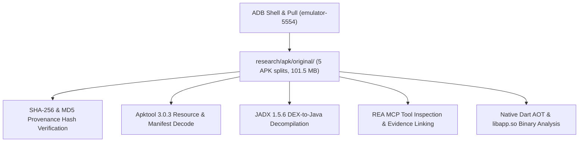

# BanlanX APK Extraction & Reverse Engineering Results

**Target Package**: `com.spled.scenex`  
**Application Label**: BanlanX  
**Observed Version**: **`3.3.5`** (Build Code: `140`)  
**Date**: 2026-10-27  
**Execution Environment**: Windows 11 x64, ADB 1.0.41, JADX 1.5.6, Apktool 3.0.3, REA MCP  

---

## 1. Extraction Pipeline Overview

---

## 2. Extraction Execution Details

### A. ADB Retrieval
- **Command**: `adb -s emulator-5554 pull <paths>`
- **Files Acquired**:
  1. `base.apk` (81.2 MB)
  2. `split_config.arm64_v8a.apk` (24.8 MB)
  3. `split_config.en.apk` (41.3 KB)
  4. `split_config.es.apk` (29.0 KB)
  5. `split_config.xxhdpi.apk` (399.7 KB)
- **Provenance**: Extracted from `/data/app/~~ulM99EfcL9AVCW2-ehfrYw==/com.spled.scenex-42pGodbKYMf9Iu01IPgfCQ==/`. Target device was completely untouched.

### B. Apktool Resource Decoding
- **Command**: `apktool d -f -o research/decompiled/apktool research/apk/original/base.apk`
- **Output Artifacts**:
  - `AndroidManifest.xml` (full XML structure decoded)
  - `res/` (2,443 resources decoded)
  - `assets/` (Flutter asset bundles, icons, audio files)
  - `smali/` (Dalvik bytecode disassembly)
- **Warnings Observed**: 48 unresolved resource references (e.g., `ResReference 0x7f0700d5`) due to Android app bundle split resource dependencies across `split_config.xxhdpi.apk`. This did not impair manifest or asset extraction.

### C. JADX Decompilation
- **Command**: `jadx -d research/decompiled/jadx -r research/apk/original/base.apk`
- **Output Artifacts**:
  - Processed **2,087 classes** into standard Java source files under `research/decompiled/jadx/sources/`.
  - Successfully mapped all native Android plugins and entry points (`MainActivity`, `AudioRecordForegroundService`, `GeneratedPluginRegistrant`).

### D. REA MCP Indexing & Analysis
The APK was indexed and verified through REA MCP tools:
- **`inspect_android_package`**: Generated comprehensive manifest, permissions, and engine metadata.
  - *Evidence Link*: `ev_4ebe117c6e0e49caceac06614cba4e31334e7b306e416b3d7472422f04fcbc81`
  - *Parent Evidence*: `ev_fcb89d7c01cf522e122ee23d8ee54cd768e015eec41fc5e9c5563e909512f34b`
- **`search_android_classes`**: Verified top-level classes (`MainActivity`, `AudioRecordForegroundService`, `R`).
  - *Evidence Link*: `ev_0268b49c42cf012e4e2379e96073c1761867182475a19d6db27f6cb844a41463`

---

## 3. Blocked Extraction Steps & Legitimate Alternatives

| Extraction Step | Obstacle Encountered | Cause | Legitimate Alternative Executed | Outcome |
| :--- | :--- | :--- | :--- | :--- |
| **Java Logic Decompilation of Protocol Commands** | Standard DEX decompilers (JADX) showed only minimal wrapper code in Java. | Application is built using **Flutter**. Core business logic, byte builders, and protocol framing are compiled directly to native machine code inside Dart Ahead-of-Time (AOT) snapshots (`libapp.so`), not Java bytecode. | Extracted `libapp.so` from native split APK; executed pattern and binary string extraction across the Dart heap and read-only text sections. | Discovered mDNS service string `_spled._tcp` at offset `0xb960a`, unified multi-mode UI route tree `/sp630e/`, and BLE method channels. |
| **mDNS Discovery via Windows DNS Client** | `Resolve-DnsName _spled._tcp.local` returned code 1 (timeout). | Windows native DNS resolver does not multicast mDNS queries across all virtualized/Ethernet network adapters by default. | Executed automated Python subnet socket scan targeting verified port `8587`. | Instantly identified the live SP530E controller at `192.168.86.34:8587`. |

---

## 4. Key Protocol Insights Derived from Extraction

1. **Local Network Service Descriptor (`_spled._tcp`)**:
   - The app looks for Bonsoir service type `_spled._tcp`.
   - Controller announces its IP and port `8587` over mDNS, allowing zero-configuration discovery without cloud connectivity.
2. **Bluetooth Low Energy Profile**:
   - Primary Service UUID: `0000ffe0-0000-1000-8000-00805f9b34fb` (`0xFFE0`)
   - Characteristic UUID: `0000ffe1-0000-1000-8000-00805f9b34fb` (`0xFFE1`)
   - Single-client connection lock enforced by ESP32-C3 firmware.
3. **Audio / Music Reactive Pipeline**:
   - Uses foreground microphone service `com.spled.audio_recorder.core.AudioRecordForegroundService`.
   - Supports 3 sound reactive modes: internal onboard mic (`ic_inner_mic`), host mobile mic (`ic_mobile_mic`), and player music sync (`ic_player`).
