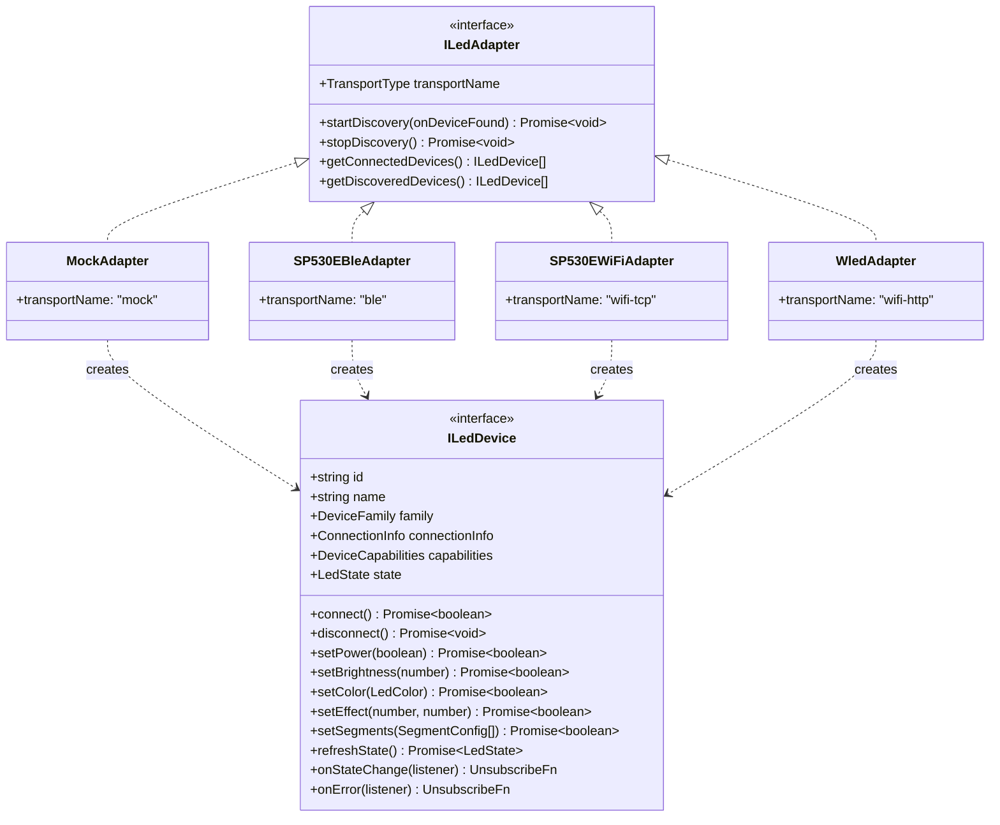
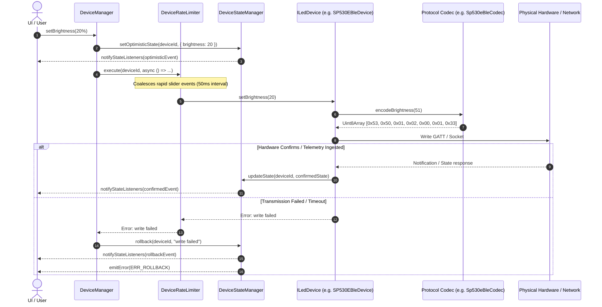

# Universal LED Controller - Modular Architecture Specification

## 1. Executive Summary & Monorepo Topology

The Universal LED Controller desktop application is built with a strictly decoupled, modular TypeScript architecture. It provides a unified Hardware Abstraction Layer (HAL) capable of controlling heterogeneous smart lighting hardware—including the **BanlanX SP530E** (via Bluetooth Low Energy and local TCP Wi-Fi) and **WLED / QuinLED dig2go** controllers (via HTTP REST and WebSocket JSON APIs)—alongside a full software simulation test harness.

The repository is structured into clear architectural domains:

```
packages/
├── core/                        # Universal Hardware Abstraction Layer & Core Services
│   ├── src/
│   │   ├── types.ts             # Discriminated domain types, interfaces & capability models
│   │   ├── color.ts             # Color space conversions (RGB, HSV, Hex, Scaling, CCT)
│   │   ├── state-manager.ts     # Central reactive state cache, subscriptions, rollback
│   │   ├── device-manager.ts    # Dependency injection, discovery orchestration, rate limiting
│   │   ├── presets.ts           # Preset & scene management, JSON import/export, safety caps
│   │   ├── diagnostics.ts       # Telemetry tracking, latency profiling, error auditing
│   │   └── index.ts             # Public API re-exports
│   └── package.json
├── adapters/                    # Pluggable hardware & simulator transport adapters
│   ├── src/
│   │   ├── mock/                # Software simulation adapter (offline development)
│   │   │   ├── mock-adapter.ts
│   │   │   └── index.ts
│   │   ├── sp530e/              # BanlanX SP530E controller adapters & codecs
│   │   │   ├── sp530e-ble-codec.ts    # 6-byte GATT frame codec & opcodes
│   │   │   ├── sp530e-ble-adapter.ts  # BLE GATT transport adapter
│   │   │   ├── spnet-codec.ts         # 13-byte SPTECH Wi-Fi TCP frame codec
│   │   │   ├── sp530e-wifi-adapter.ts # Wi-Fi socket transport adapter
│   │   │   └── index.ts
│   │   ├── wled/                # WLED / QuinLED dig2go adapter & JSON codec
│   │   │   ├── wled-codec.ts          # JSON state & info serializer/deserializer
│   │   │   ├── wled-adapter.ts        # HTTP REST / WebSocket adapter
│   │   │   └── index.ts
│   │   └── index.ts             # Public API re-exports
│   └── package.json
└── ui/                          # Desktop Presentation Layer (Electron + React)
    ├── src/
    └── package.json
```

---

## 2. Universal Hardware Abstraction Layer (HAL)

### 2.1 Core Contracts: `ILedDevice` & `ILedAdapter`

The HAL is governed by two fundamental interfaces defined in `packages/core/src/types.ts`:

1. **`ILedDevice`**: Represents an individual controllable physical or virtual light strip. Exposes normalized control methods (`setPower`, `setBrightness`, `setColor`, `setEffect`, `setSegments`, `setMusicMode`), live `state: LedState`, static and dynamic `capabilities: DeviceCapabilities`, and event emitter subscriptions (`onStateChange`, `onError`).
2. **`ILedAdapter`**: Represents a transport-level provider (`mock`, `ble`, `wifi-tcp`, `wifi-http`, `websocket`). Manages adapter lifecycle, discovery of hardware devices on the local medium, and device tracking.



### 2.2 Dependency Injection Container (`DeviceManager`)

`DeviceManager` acts as the single source of truth and orchestration engine:
- **Adapter Registration**: Any adapter conforming to `ILedAdapter` can be registered at boot (`registerAdapter(adapter)`).
- **Concurrent Discovery**: Calling `startDiscovery()` broadcasts discovery across all registered adapters concurrently using `Promise.all`.
- **Dry-Run Enforcement**: Supports a global `setDryRun(true)` mode to facilitate unit tests and safe user inspection without mutating physical hardware.
- **Connection Timeout Guard**: Prevents hanging socket or BLE calls by wrapping connections with configurable timeouts (`connectDevice(id, timeoutMs)`).

---

## 3. Data Flow & Reactive State Architecture



### 3.1 Optimistic Updates with Rollback
The `DeviceStateManager` provides a responsive user experience by immediately broadcasting optimistic state updates to the UI subscribers. If the physical controller rejects the command or times out, `rollback(deviceId)` automatically restores the last known good hardware state and triggers a user-facing error notification.

### 3.2 Command Rate Limiting & Coalescing
User actions such as dragging a color wheel or brightness slider produce events at 60 Hz or higher. Physical microcontrollers (especially on BLE GATT) will drop packets or freeze if flooded. `DeviceRateLimiter` enforces a 50ms cooldown window (20 Hz max) per device:
- The first event executes immediately.
- Subsequent events within 50ms are coalesced into a single trailing execution containing the latest parameters.
- All promises from coalesced callers resolve cleanly when the trailing execution completes.

---

## 4. Hardware Adapters Overview

| Adapter | Device Family | Transport | Port / UUID | Protocol Framing | Key Features |
| :--- | :--- | :--- | :--- | :--- | :--- |
| **`MockAdapter`** | `mock` / `sp530e` / `wled` | In-memory | `mock://` | Direct object mutation | Full simulation for offline UI development and automated tests. |
| **`SP530EBleAdapter`** | `sp530e` | Bluetooth LE GATT | Svc: `0xFFE0`<br>Char: `0xFFE1` | 6-byte header: `0x53 0x50 [seq] [opcode] [len_h] [len_l] [payload]` | Direct BLE radio control; dry-run frame inspection; notification telemetry ingestion. |
| **`SP530EWiFiAdapter`** | `sp530e` | Wi-Fi TCP Socket | TCP port `8587` | 13-byte header: `SPTECH\0 [type] [key] [total] [num] [len_h] [len_l] [payload]` | High-speed local LAN control; live telemetry queries; multi-segment reporting. |
| **`WledAdapter`** | `wled` | HTTP REST / WebSocket | HTTP port `80` (or custom) | JSON API (`/json/state`, `/json/info`) | Industry-standard WLED control; automatic hardware ABL protection; segment arrays. |

---

## 5. Safety, Fault Tolerance & Presets

1. **Hardware Safety Limits**:
   - `DeviceCapabilities.brightnessRange.safetyLimit` defaults to 20% on development setups to protect 5V/12V power injection and strips from thermal overload.
   - All brightness setters and presets enforce `Math.min(brightness, safetyLimit)`.
2. **Dry-Run Mode**:
   - Every physical adapter supports dry-run operation, encoding and verifying frames in memory without initiating unapproved radio or network transmissions.
3. **Preset Management**:
   - `PresetManager` ships with factory presets: *Warm White (20% Safe)*, *Daylight Cool White (20%)*, *Cyberpunk Cyan*, and *Rainbow Wave Effect*.
   - Supports CRUD operations, device filtering, and JSON import/export for user scene sharing.
4. **Diagnostics & Telemetry**:
   - `DiagnosticsService` records byte counters, packet tallies, round-trip latency statistics, and error logs across all active devices for troubleshooting.
