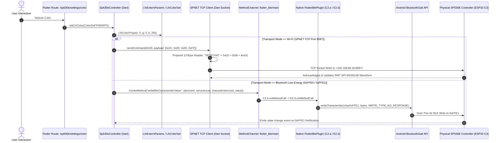
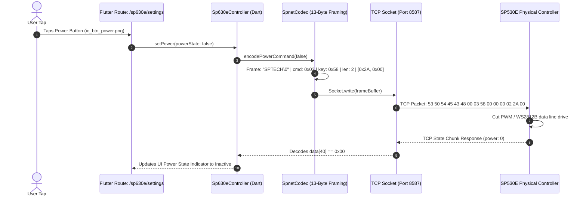
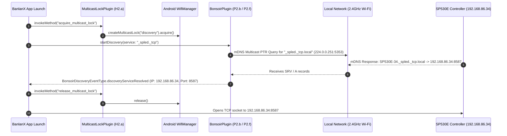
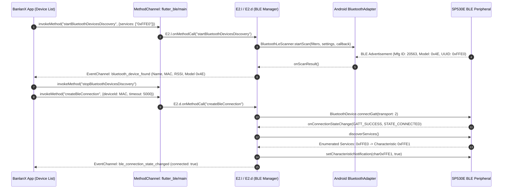

# SP530E Command Call Graphs & Architectural Traces

**Scope**: End-to-end execution flow from representative UI actions in BanlanX to outgoing wire transmissions.  
**Frameworks Covered**: Flutter Presentation Layer, Native Android Host, Wi-Fi Socket, and BLE GATT.  

---

## 1. Representative UI Action: Color Change Call Graph

This trace demonstrates the end-to-end execution flow when a user selects a color (e.g. Blue `#0000FF`) on the color wheel:

---

## 2. Power Toggle Call Graph

---

## 3. Wi-Fi Local Discovery Lifecycle (`_spled._tcp`)

---

## 4. Bluetooth LE Discovery & Connection Lifecycle

