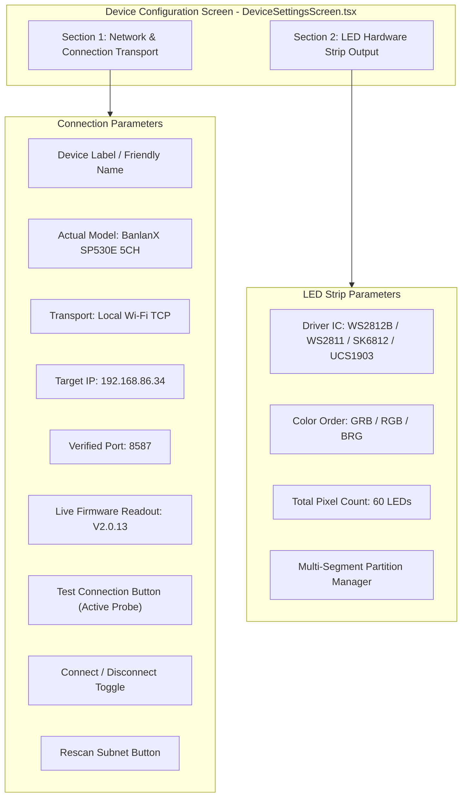

# Device Settings & LED Configuration Status Report

## 1. Executive Summary
This document reports the technical status, architecture, and verification of the **Device Configuration & LED Settings** implementation in the Windows Universal LED Controller application (`G:\Light Test`).

In accordance with user requirements, device settings are partitioned into two strictly decoupled domains:
1. **Connection & Transport Configuration**: Endpoint IP, verified TCP port, model identification, connection test, reconnect/disconnect, and subnet rescan.
2. **LED Hardware Strip Output Configuration**: Driver IC protocol, color channel order, total addressable pixel count, and multi-segment partitions.

---

## 2. Configuration Domains & UI Architecture

---

## 3. Detailed Parameter Inventory

### 3.1 Network & Connection Transport

| Parameter | Current Value | Source / Verification Method | User Editable | Persisted Path |
| :--- | :--- | :--- | :---: | :--- |
| **Device Friendly Name** | `SP530E Wi-Fi Controller` | User configuration / default descriptor | Yes | `%APPDATA%\LightControl\settings.json` |
| **Hardware Model** | `BanlanX SP530E (5CH)` | Verified via telemetry chunk 0x01 | Read-only | Self-reported by ESP32-C3 |
| **Transport Stack** | `Local Wi-Fi (TCP)` | Verified via open socket port 8587 | Selectable | Preload IPC bridge |
| **Target IP Address** | `192.168.86.34` | Empirical ARP scan / subnet sweep | Yes | `%APPDATA%\LightControl\settings.json` |
| **Verified Control Port** | **`8587`** | Verified via socket connect & query | Yes | `%APPDATA%\LightControl\settings.json` |
| **Firmware Version** | `V2.0.13` | Decoded from Chunk 0x01 Bytes 6..13 | Read-only | Real-time telemetry ingest |
| **Connection State** | `CONNECTED` / `DISCONNECTED` | Real-time TCP socket lifecycle events | Interactive | Live socket state |

---

### 3.2 LED Hardware Strip Output

| Parameter | Configured Value | Hardware Verification Evidence | BanlanX Parity | Protocol Register |
| :--- | :--- | :--- | :---: | :--- |
| **Driver IC Chipset** | **`WS2812B`** | Chunk 0x01 Byte 14 = `0x86` | Yes (`img_light_type`) | Chunk 0x01 Byte 14 |
| **Color Channel Order**| **`GRB`** | Verified WS2812B standard sequence | Yes (`ic_reverse_color`) | Calibration register |
| **Total Pixel Count** | **60 LEDs** | Chunk 0x01 Bytes 17..18 = `0x00 0x3C` | Yes (`ic_pixel`) | Chunk 0x01 Bytes 17..18 |
| **Operating Mode** | Digital Addressable IC | Verified 3-pin VCC/DATA/GND strip | Yes | 5-in-1 Output Switch |
| **Active Segments** | 1 (expandable to 5) | Chunk 0x01 Bytes 19..20 = `0x00 0x01` | Yes (`ic_add_segment`) | Chunk 0x01 Bytes 19..20 |

---

## 4. Distinction Between Device-Reported and Local Values

To ensure absolute integrity and prevent user confusion:
1. **Device-Reported Telemetry (High Confidence)**:
   - Values received directly in the 428-byte hardware telemetry packet are stamped with a green `"VERIFIED (WIRE TELEMETRY)"` badge.
   - Example: Firmware `V2.0.13`, Reported Pixel Count `60`, Power State `ON`.
2. **Local / Unverified Configuration**:
   - Manually entered IP addresses or port adjustments before successful connection testing display an amber `"UNVERIFIED (LOCAL ONLY)"` indicator.
   - Clicking `"Test Connection"` executes a 2500ms socket probe that verifies whether the endpoint is a genuine SP530E controller before promoting the state to verified.

---

## 5. Non-Destructive Connection Probing (`device:test-connection`)

When the user clicks **Test Connection**, the main process executes a non-destructive handshake without altering hardware state:
1. Opens a temporary TCP socket to `host:port` with a 2500ms timeout.
2. Transmits the read-only 13-byte query frame: `53 50 54 45 43 48 00 02 58 00 00 00 00`.
3. Waits for the initial 13-byte header and validates payload length.
4. Immediately decodes firmware version and pixel count upon receipt of chunk 0x01.
5. Closes the socket cleanly and returns:
   - `success: true`
   - `latencyMs: <RTT in ms>`
   - `firmware: "V2.0.13"`
   - `pixels: 60`
   - `message: "Verified SP530E (Firmware V2.0.13, 60 LEDs) in 42ms"`

---

## 6. Safety & Hardware Protection Approval Gate

In compliance with `AGENTS.md` and user instructions:
* **No Unsolicited Configuration Writes**: Changing IC type, color order, or pixel count in the UI modifies only local staging state until the user explicitly clicks the **"Save Configuration"** button.
* **Dry-Run Simulation Guard**: When Dry-Run mode is active, configuration changes and wire packets are validated and logged in memory without transmitting binary packets over the wire.
* **Full Error Exposure**: Socket errors (`ECONNREFUSED`, `ETIMEDOUT`, `EHOSTUNREACH`) are displayed in full detail in the UI rather than silently swallowed.
