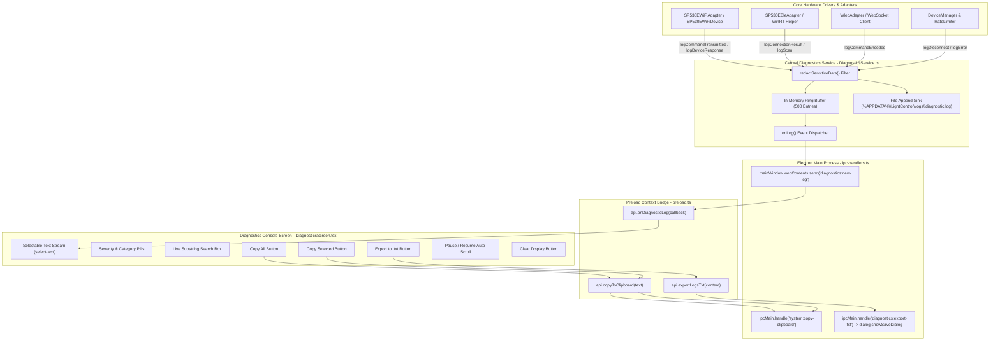

# Diagnostic Logging & Protocol Auditing Architecture

## 1. Executive Summary
This document specifies the technical design, IPC communication, and user interaction mechanics of the **Diagnostic Logging & Protocol Auditing System** implemented in the Windows Universal LED Controller application (`G:\Light Test`).

The logging subsystem provides comprehensive visibility into protocol encoding, network transport, hardware responses, and socket lifecycles, while guaranteeing:
1. **Unrestricted Text Selection**: Full mouse and keyboard selection across timestamps, categories, and messages.
2. **One-Click Clipboard & Export Tools**: Native Electron clipboard and file-save dialog integration functional in both development and packaged portable EXE modes.
3. **Non-Volatile Persistence**: Logs are persisted to `%APPDATA%\LightControl\logs\diagnostic.log`, guaranteeing preservation across portable executable extractions and restarts.
4. **Data Redaction**: Automatic scrubbing of sensitive credentials, tokens, and passwords.

---

## 2. Architecture & Data Flow



---

## 3. Log Console Features & User Controls

### 3.1 Unrestricted Text Selection (`select-text`)
* **Problem in Earlier Versions**: Global CSS (`select-none`) prevented users from highlighting text or copying error messages directly from the console.
* **Fix Applied**: The log container in `DiagnosticsScreen.tsx` is explicitly tagged with `select-text cursor-text`. Timestamps, severity badges, category tags, and payload hex strings can be clicked and dragged natively using standard Windows selection cursors.

### 3.2 Native Clipboard Actions
* **Copy All Button**:
  - Formats every currently filtered entry into a structured single string:
    `[HH:mm:ss.SSS] [LEVEL] [CATEGORY] [dev:id] [action] message | data={...}`
  - Transmits string to the Electron main process via `system:copy-clipboard` which invokes `electron.clipboard.writeText()`.
  - Includes browser `navigator.clipboard` fallback.
  - Displays a temporary cyan feedback badge confirming: `"Copied all N logs to clipboard!"`.
* **Copy Selected Button**:
  - Queries `window.getSelection()?.toString()`.
  - If the user has highlighted a specific hex chunk, opcode, or error traceback, clicking **Copy Selected** transfers the exact highlighted substring into the Windows clipboard.
  - If no text is selected, prompts user: `"Highlight text in the log console first to copy selection."`.

### 3.3 Native Export to `.txt`
* **File Save Mechanism**:
  - Invokes `window.api.exportLogsTxt(content)` which calls Electron's native `dialog.showSaveDialog(mainWindow, { defaultPath: 'LightControl-Diagnostics-YYYY-MM-DD.txt' })`.
  - Pre-populates a standardized audit header including version metadata, timestamp, filter criteria, and target hardware endpoint.
  - Fully functional in the single portable `.exe` build without external shell dependencies.

### 3.4 Pause & Auto-Scroll Controls
* **Toggle Button**: Allows the operator to switch between `"Auto-Scroll Active"` and `"Auto-Scroll Paused"`.
* **Auto-Scroll Behavior**: When active, arriving logs scroll the `logContainerRef` element directly to `scrollHeight`. When paused, the scroll position remains fixed, allowing comfortable inspection of past trace events during high-rate packet streams.

### 3.5 Real-Time Search & Multi-Dimensional Filtering
* **Search Box**: Fast client-side substring matching across message text, opcode identifiers, IP addresses, and payload hex values.
* **Severity Filters**: `ALL`, `INFO`, `WARN`, `ERROR`, `DEBUG`.
* **Category Filters**:
  * `SCAN`: Discovery start, stop, sweeps, and network probes.
  * `DISCOVERY`: Discovered devices, metadata updates, offline removals.
  * `CONNECTION`: TCP SYN-ACK, handshake, socket timeouts, drops, and reconnects.
  * `TRANSMIT`: Wire writes, packet byte lengths, and transport acknowledgments.
  * `RECEIVE`: Ingested response frames, latency measurements, and telemetry chunk decodes.
  * `PROTOCOL`: SpnetCodec / BleCodec frame builders and checksum validations.
  * `IPC`: Preload and renderer-to-main channel invocations.
  * `SYSTEM`: Adapter initialization, configuration persistence, and adapter registrations.

---

## 4. Log Entry Format & Millisecond Precision

All timestamps are formatted to millisecond accuracy (`HH:mm:ss.SSS` or full ISO-8601):

```text
[18:54:12.345] [INFO ] [CONNECTION] [dev:sp530e-wifi-192-168-86-34] [CONNECT_ATTEMPT] Attempting connection to sp530e-wifi-192-168-86-34 via wifi-tcp at 192.168.86.34:8587 | data={"address":"192.168.86.34:8587"}
[18:54:12.394] [INFO ] [CONNECTION] [dev:sp530e-wifi-192-168-86-34] [CONNECT_SUCCESS] Successfully connected to sp530e-wifi-192-168-86-34 via wifi-tcp
[18:54:12.395] [DEBUG] [PROTOCOL  ] [dev:sp530e-wifi-192-168-86-34] [ENCODE_COMMAND] Command encoded [State Query] for sp530e-wifi-192-168-86-34: 53505445434800025800000000
[18:54:12.440] [INFO ] [TRANSMIT  ] [dev:sp530e-wifi-192-168-86-34] [TRANSMITTED] Transmitted [State Query] (13B) to sp530e-wifi-192-168-86-34: 53505445434800025800000000 | data={"bytesLength":13}
[18:54:12.544] [INFO ] [RECEIVE   ] [dev:sp530e-wifi-192-168-86-34] [RESPONSE_RECEIVED] Received response from sp530e-wifi-192-168-86-34 (104ms): 5350544543480002000000019f01010011001e56322e302e313320860303003c0001... | data={"latencyMs":104}
```

---

## 5. Non-Volatile Persistence & Portable Safety

When the application runs from `G:\Light Test\release\LightControl-Portable.exe`, Electron extracts runtime files into a temporary directory (`%TEMP%\electron-...`). 
* **Safe Log Path**: The diagnostics service explicitly overrides the default log destination, resolving to:
  `C:\Users\<User>\AppData\Roaming\LightControl\logs\diagnostic.log`
* **Log Retention**: Closing or reopening the portable `.exe` never purges past log records.
* **Sensitive Redaction**: The `redactSensitiveData()` recursive sanitizer scrub passwords, tokens, API keys, and private credentials before writing to disk or broadcasting over IPC.
