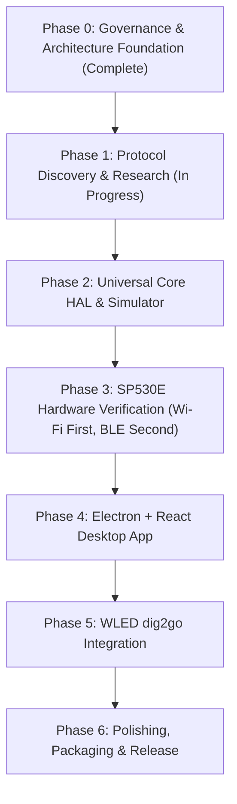

# Windows LED Controller - Master Project Plan

## 1. Executive Summary
The goal of this project is to develop an independent, modern Windows 10/11 desktop application to control LED controllers. The initial priority is the BanlanX-compatible **SP530E** controller (supporting both local Wi-Fi via `SPNET` and Bluetooth Low Energy), followed by the **QuinLED dig2go** running WLED (via HTTP/WebSocket).

The application is built on a **Universal LED Device Interface** supporting runtime capability detection, ensuring hardware-agnostic control, robust offline operation, and clean extensibility.

---

## 2. Updated Project Roadmap & Phases

### Phase 0: Governance, Document Setup & Environment Audit (COMPLETE)
- Established persistent agent guidelines (`AGENTS.md`).
- Initialized documentation suite (`PROJECT_PLAN.md`, `PROGRESS.md`, `DECISIONS.md`, `FEATURE_MATRIX.md`, `PROTOCOL_FINDINGS.md`, `HARDWARE_TESTS.md`, `ENVIRONMENT.md`).
- Initialized Git repository with strict `.gitignore` and monorepo directories (`packages/`, `apps/`, `research/`, `protocol/`).
- Verified complete environment (Node v24.13, npm 11.6, Git 2.52, Python 3.8, Java 21, Apktool 3.0.3, Wireshark 4.6.9, JADX MCP 0.7.1, Realtek BLE).

### Phase 1: Protocol Discovery & Clean-Room Static RE (CURRENT)
- **Completed Deliverables**:
  - `docs/SP530E_RESEARCH.md`: Complete hardware specifications, IC list, 12 modes, BLE GATT profile (`0xFFE0`/`0xFFE1`), model code `0x4E`, and `SPNET` TCP/UDP port 8587 framing.
  - `docs/WLED_RESEARCH.md`: Complete WLED JSON API (`/json`), WebSocket (`/ws`), mDNS discovery (`_wled._tcp`), and QuinLED dig2go hardware architecture (level shifter, mic, 3A limit).
  - `docs/PROTOCOL_REFERENCE_LINKS.md`: Full bibliography of datasheets, repos, and issue threads.
  - `docs/RESEARCH_GAPS.md`: Ledger of verified facts vs. unverified hypotheses.
- **Pending Tasks**:
  1. Pull `com.spled.scenex` APK from `emulator-5554` into `research/apk/`.
  2. Inspect decompiled Java sources using JADX MCP to extract exact command opcodes, payload chunk definitions, and checksum algorithms.
  3. Formulate verified byte-level protocol specifications without fabricating commands.

### Phase 2: Universal Core HAL & Simulator
- **Tasks**:
  1. Implement TypeScript domain models (`ILedDevice`, `ILedAdapter`, `DeviceCapabilities`, `LedState`) in `packages/core`.
  2. Implement `MockAdapter` simulating SP530E (12-mode, WS2812B, 146 effects) and WLED (segments, 100+ effects).
  3. Write comprehensive unit test suite in `tests/` verifying capability checks and state transitions.

### Phase 3: Hardware Verification & Adapter Implementation
- **Recommended Execution Order**: **Local Wi-Fi First, BLE Second** (See Section 3 below).
- **Tasks**:
  1. Implement `SP530EWiFiAdapter` using Node.js built-in `net` (TCP port 8587) and `dgram` (UDP discovery).
  2. Test UDP broadcast discovery and TCP state query with physical SP530E.
  3. Implement `SP530EBleAdapter` using Windows BLE for offline/direct transport.
  4. Test live color, brightness, and effect commands on physical SP530E + WS2812B strip under strict safety bounds (20% brightness cap).

### Phase 4: Desktop Application Frontend & Electron Shell
- Scaffold Electron app with Vite, React, TypeScript, and Tailwind CSS.
- Configure context isolation and sandboxed preload IPC.
- Build capability-driven UI widgets (RGB color wheel, effect selector, speed/brightness sliders).

### Phase 5: WLED Integration (QuinLED dig2go)
- Implement `WledAdapter` supporting REST `/json/state` and WebSocket `/ws`.
- Implement mDNS discovery for `_wled._tcp`.
- Map WLED segments, presets, and audio reactivity.

### Phase 6: Packaging & Release
- Windows 10/11 installer packaging (`.exe` / MSIX).
- Final documentation and test sign-off.

---

## 3. Transport Recommendation: Why Test SP530E Local Wi-Fi Before BLE?

Based on our empirical research into the ESP32-C3 hardware and protocol architecture, we **recommend testing Local Wi-Fi (SPNET port 8587) first, followed by BLE second**, provided the controller is provisioned to the local network:

| Factor | Local Wi-Fi (`SPNET` TCP/UDP 8587) | Bluetooth Low Energy (`0xFFE0` / `0xFFE1`) |
| :--- | :--- | :--- |
| **Node.js Native Support** | **Superior**: Uses built-in `net` and `dgram` modules. Zero native C++ compilation, zero binary addons, zero node-gyp issues. | **Fragile**: Requires native WinRT bindings (`@abandonware/noble`) or external C# IPC helper process (ADR-004). |
| **Connection Exclusivity** | **Multi-Client**: ESP32 TCP server accepts concurrent connections. Phone app and PC can coexist. | **Single-Client Lock**: Controller firmware rejects PC connection if mobile app has an active BLE handle. |
| **Transmission Range** | Entire local home network / subnet. | Confined to Bluetooth range (<10 meters). |
| **Throughput & Latency** | High throughput, reliable packet delivery via TCP. | Subject to BLE MTU fragmentation and packet drops. |
| **Prerequisite** | Device must be paired to 2.4GHz Wi-Fi via BanlanX once. | Works unprovisioned out of the box. |

**Strategic Strategy**:
* If the user's SP530E is already connected to their 2.4GHz Wi-Fi network, proceed with **Local Wi-Fi adapter development first**.
* If the SP530E is not on Wi-Fi, use the BanlanX app to pair it to Wi-Fi once, or develop the BLE adapter as the fallback direct transport.

---

## 4. Risk Assessment & Mitigation Matrix

| Risk ID | Risk Description | Severity | Probability | Mitigation Strategy |
| :--- | :--- | :---: | :---: | :--- |
| **RSK-01** | **Windows BLE Native Stack Instability** | High | Medium | Prioritize Wi-Fi transport. Decouple BLE behind an IPC boundary if native Node BLE encounters WinRT quirks. |
| **RSK-02** | **BLE Single-Client Lock Contention** | Medium | High | Display clear UI warning when BLE connection fails, advising user to close the BanlanX mobile app. |
| **RSK-03** | **Hardware Overload on WS2812B Strip** | High | Low | Enforce conservative software limits (20% brightness cap, safe pixel counts) until user confirms power supply capacity. |
| **RSK-04** | **Unverified Protocol Opcode Injection** | High | Low | Never fabricate opcodes. Extract exact byte layouts from the decompiled APK before transmitting to hardware. |
| **RSK-05** | **Proprietary Code Ingestion Risk** | High | Low | Strict clean-room implementation. No decompiled assets committed to repository. Protocol specifications cleanly rewritten in TypeScript. |
