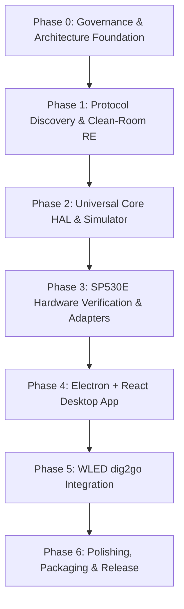

# Windows LED Controller - Master Project Plan

## 1. Executive Summary
The goal of this project is to develop an independent, modern Windows 10/11 desktop application to control LED controllers. The initial priority is the BanlanX-compatible **SP530E** controller (via Bluetooth Low Energy and Wi-Fi if feasible), followed by the **QuinLED dig2go** running WLED (via HTTP/WebSocket).

The application is built on a **Universal LED Device Interface** supporting runtime capability detection, ensuring hardware-agnostic control, robust offline operation, and clean extensibility.

---

## 2. Project Roadmap & Phases

### Phase 0: Governance, Document Setup & Risk Assessment (Current)
- Establish persistent agent guidelines (`AGENTS.md`).
- Define repository structure, documentation suite, and architectural boundaries.
- Formulate comprehensive risk mitigation strategies.
- Check local environment dependencies (Node.js, ADB, Windows BLE capabilities).

### Phase 1: Protocol Discovery & Clean-Room Reverse Engineering
- **Target**: BanlanX Android application and SP530E communication.
- **Tasks**:
  1. Survey existing open-source reverse-engineering work and community research on BanlanX / SP-series LED controllers.
  2. Inspect BanlanX APK via REA / decompilation tools strictly for protocol message structures, UUIDs, checksums, and framing.
  3. Analyze Bluetooth Low Energy (BLE) GATT profile: Service UUIDs, Characteristic UUIDs (Read/Write/Notify).
  4. Investigate Wi-Fi communication mechanisms: Local UDP/TCP broadcast, socket protocols, cloud relay requirements.
  5. Document all byte layouts, command codes, and state response formats in `docs/PROTOCOL_FINDINGS.md`.
  6. **No hardware transmission** will occur during this phase without prior protocol verification and user consent.

### Phase 2: Universal Core HAL & Simulator
- **Tasks**:
  1. Define TypeScript domain models (`ILedDevice`, `ILedAdapter`, `DeviceCapabilities`, `LedState`).
  2. Implement capability detection schema (Power, Brightness, RGB, CCT, IC Addressable, Dynamic Modes, Music Reactive, Segments).
  3. Build `MockAdapter` simulating SP530E and WLED devices for rapid development without physical hardware risks.
  4. Create unit tests verifying capability checks and command translation.

### Phase 3: SP530E Hardware Verification & Adapter Implementation
- **Tasks**:
  1. Evaluate Windows BLE transport options (Node.js native BLE libraries vs. C# WinRT IPC helper).
  2. Implement `SP530EBleAdapter` adhering to `ILedAdapter`.
  3. Define safe hardware testing procedures in `docs/HARDWARE_TESTS.md`.
  4. Request user approval for controlled read-only and command transmissions.
  5. If Wi-Fi protocol is locally accessible without cloud dependencies, implement `SP530EWiFiAdapter`.

### Phase 4: Desktop Application Frontend & Electron Shell
- **Tasks**:
  1. Scaffold Electron application with Vite, React, and TypeScript.
  2. Configure secure Electron IPC (Context Isolation, Sandboxed Preload, no Node integration in renderer).
  3. Build UI components dynamically rendered based on device capabilities:
     - Device Discovery & Connection Manager.
     - Color Picker (HSB, RGB, White channel balance).
     - Effect Browser & Speed/Intensity controls.
     - Mode switcher (Solid, Pattern, Music/Sound, DIY).
  4. Implement persistent device settings and local state caching.

### Phase 5: WLED Integration (QuinLED dig2go)
- **Tasks**:
  1. Implement `WledAdapter` supporting WLED JSON API and WebSocket live streaming.
  2. Map WLED native capabilities (segments, palettes, 100+ effects) into the universal model.
  3. Test side-by-side management of SP530E and WLED controllers.

### Phase 6: Packaging, Polish & Hardening
- **Tasks**:
  1. Package executable installer for Windows 10/11 (`.exe` / MSIX).
  2. Auto-reconnection and fault recovery testing.
  3. Final documentation update and user guide.

---

## 3. Risk Assessment & Mitigation Matrix

| Risk ID | Risk Description | Severity | Probability | Mitigation Strategy |
| :--- | :--- | :---: | :---: | :--- |
| **RSK-01** | **Windows BLE Native Stack Instability in Node.js** Node.js native BLE modules (e.g., `@abandonware/noble`) frequently encounter build issues or WinRT driver compatibility glitches on newer Windows 10/11 builds. | High | Medium | Decouple the BLE transport behind an IPC boundary. If native Node WinRT fails, deploy a lightweight .NET/C# console helper utilizing official `Windows.Devices.Bluetooth` WinRT APIs, communicating via standard stdin/stdout JSON-RPC. |
| **RSK-02** | **Protocol Encryption / Cloud Dependency** SP530E Wi-Fi mode might require proprietary Tuya/BanlanX cloud authentication or encrypted handshake, making pure local LAN control unfeasible. | High | Medium | Prioritize BLE as the primary local transport, which is typically direct and local. Treat Wi-Fi as an opportunistic enhancement only if an unencrypted or locally decryptable protocol is verified. |
| **RSK-03** | **Hardware Damage via Invalid Configuration** Sending incorrect IC type, excessive pixel counts, or rapid invalid command sequences could cause controller lockups or strip glitches. | High | Low | Enforce strict parameter validation in the adapter layer. Set conservative default limits on pixel count and power. Request user sign-off on initial live test sequences. |
| **RSK-04** | **Firmware Divergence / Protocol Variance** Different SP530E firmware revisions or BanlanX variants may alter packet structures or checksum algorithms. | Medium | Medium | Implement protocol version detection or multiple packet dialects. Design adapters with modular packet encoders/decoders. |
| **RSK-05** | **Proprietary Code Ingestion Legal/Ethical Risk** Reverse engineering could risk copyright infringement if proprietary assets or decompiled code are incorporated into the project. | High | Low | Strict clean-room implementation policy documented in `AGENTS.md`. No proprietary files checked into Git. Only protocol specifications (byte schemas) are retained. |
| **RSK-06** | **Latency & Dropped Packets over BLE** High-frequency color changes (e.g., music reactive modes or fast sliders) can overwhelm BLE notification buffers. | Medium | High | Implement client-side command throttling, coalescing (sliding-window dropping of intermediate slider frames), and response acknowledgments. |

---

## 4. Immediate Next Actions
1. Initialize project documentation suite (`PROGRESS.md`, `DECISIONS.md`, `FEATURE_MATRIX.md`, `PROTOCOL_FINDINGS.md`, `HARDWARE_TESTS.md`).
2. Scaffold repository directory layout.
3. Conduct Stage 1 research: Public protocol documentation and preliminary BanlanX APK inspection.
