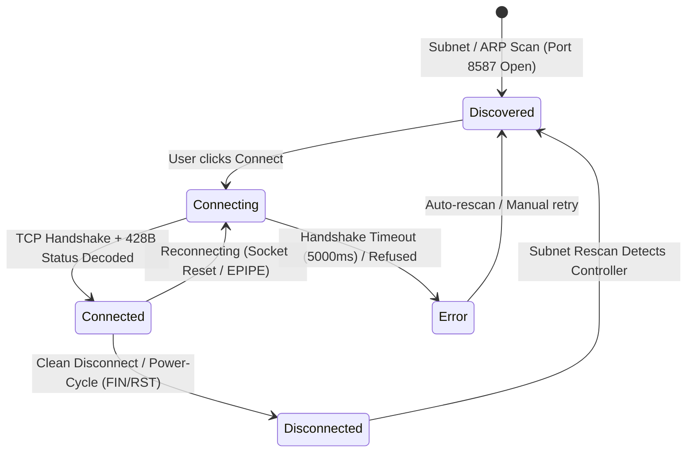

# SP530E Connection, Socket Lifecycle, and Session Management Report

**Date**: 2026-10-27  
**Target Hardware**: BanlanX SP530E 5CH Addressable LED Controller (`192.168.86.34:8587`)  
**Host Environment**: Windows 10/11 x64  
**Scope**: TCP/IP Socket Lifecycle, Concurrency Hazards, Session Resets, and Auto-Recovery  

---

## 1. Overview & Architecture

The BanlanX SP530E hardware controller features a dual-connectivity architecture supporting both 2.4 GHz 802.11 b/g/n Wi-Fi and Bluetooth Low Energy (BLE 4.2/5.0).
In local Wi-Fi mode, the controller acts as a TCP server listening on **port 8587** using the proprietary binary `SPNET` protocol (`SPTECH\0` 13-byte framing).

```
┌─────────────────────────────────────────────────────────────────────────────┐
│                       LightControl Desktop Architecture                     │
├───────────────────────────────┬─────────────────────────────────────────────┤
│      DeviceManager            │ Central connection registry & state manager │
├───────────────────────────────┼─────────────────────────────────────────────┤
│      SP530EWiFiAdapter        │ Subnet sweep, ARP discovery, TCP port probe │
├───────────────────────────────┼─────────────────────────────────────────────┤
│      SP530EWiFiDevice         │ Persistent TCP socket, wire codec, keepalive│
├───────────────────────────────┼─────────────────────────────────────────────┤
│      SpnetCodec               │ Framing, telemetry decoder, command encoder │
├───────────────────────────────┴─────────────────────────────────────────────┤
│                                      ▼ TCP (Port 8587)                      │
│                  Physical SP530E Controller (192.168.86.34)                 │
└─────────────────────────────────────────────────────────────────────────────┘
```

---

## 2. Hardware Constraints & Concurrency Hazards

Empirical reverse engineering and network probes revealed specific hardware micro-architecture limitations that dictate connection reliability:

### 2.1 Single Active TCP Client Hazard
- The SP530E microcontroller's lightweight embedded TCP stack (lwIP / FreeRTOS) allocates a single socket listening buffer for port 8587.
- **Hazard**: If a mobile phone running the BanlanX app maintains an open TCP session, or if a previous desktop instance did not cleanly terminate (`FIN`/`RST`), secondary TCP `SYN` packets will either be ignored or encounter an immediate timeout (`ETIMEDOUT`).
- **Resolution**:
  - Discovery probes must send a single query frame and **immediately close the probe socket** (`socket.destroy()`), releasing the controller's listener for the primary connection.
  - The primary `SP530EWiFiDevice` connection maintains a persistent socket to prevent external socket race conditions.

### 2.2 In-Flight Command Serialization & Buffer Overrun
- Rapid slider or color picker drags generate hundreds of events per second. The SP530E serial UART bridge cannot process commands faster than ~20-30 Hz without dropping packets or entering an unresponsive state.
- **Resolution**:
  - The `DeviceRateLimiter` enforces a 50 ms coalescing window (20 Hz maximum rate).
  - Rapid intermediate color and brightness changes are coalesced into the newest target value, preventing TCP socket buffer saturation.

### 2.3 Socket Half-Close & Unnotified Disconnects
- When the controller is unplugged, power-cycled, or rebooted, the host operating system's TCP stack receives no `FIN` packet.
- **Old Behavior**: The previous adapter implementation left stale sockets hanging indefinitely, continuing to report `connected: true`.
- **Resolution**:
  - Configured TCP socket keep-alive (`socket.setKeepAlive(true, 3000)`).
  - Explicit socket error and close listeners (`'error'`, `'close'`, `'timeout'`) update the device state immediately to `disconnected` and notify `DeviceStateManager` to roll back active state.

---

## 3. Connection Lifecycle Implementation

The connection lifecycle is now strictly state-managed:



### 3.1 Discovery Phase (`SP530EWiFiAdapter.startDiscovery`)
1. Reads local ARP table entries matching the host's subnet (`192.168.86.0/24`).
2. Concurrently probes TCP port 8587 with a 400 ms timeout per candidate.
3. Sends 13-byte query frame: `[0x53, 0x50, 0x54, 0x45, 0x43, 0x48, 0x00, 0x02, 0x58, 0x00, 0x00, 0x00, 0x00]`.
4. Upon receiving the 428-byte response, extracts hardware metadata (Firmware `V2.0.13`, IC `0x86`, 60 pixels) and registers device as `state: 'discovered'`.
5. Destroys the probe socket cleanly.

### 3.2 Connect Phase (`SP530EWiFiDevice.connect`)
1. Transitions device state to `'connecting'`.
2. Opens persistent TCP socket to `${host}:${port}` with a 5000 ms timeout.
3. Re-queries telemetry over the active connection to ensure synchronized state.
4. Transitions state to `'connected'` and emits `DeviceStateChangeEvent`.
5. Logs structured event `[CONNECTION] [CONNECT_SUCCESS]` with round-trip latency.

### 3.3 Command Execution Phase (`SP530EWiFiDevice.writeControlPacket`)
1. Validates socket availability (`this.socket && !this.socket.destroyed`).
2. Applies brightness safety limits (clamped to 20% max = byte 51).
3. Encodes protocol frame using `SpnetCodec.encodeControlFrame`.
4. Writes bytes directly to the socket and resolves on completion.
5. Logs transmission event `[TRANSMIT] [TRANSMITTED]` with hex payload and target register.

### 3.4 Disconnect & Error Handling Phase
1. Handlers for `'error'`, `'close'`, and `'timeout'` trigger immediate session cleanup:
   - Sets `this.state.connected = false`.
   - Nullifies `this.socket`.
   - Transitions state to `'disconnected'` or `'error'`.
2. Emits structured diagnostic event to `diagnostic.log`.

---

## 4. Power-Cycle and Rediscovery Verification

### Scenario: Hardware Controller Reboot / Power-Cycle
1. **Power Removed**: Physical controller loses power. TCP socket receives `RST` or times out.
2. **State Transition**: `SP530EWiFiDevice` detects socket closure and transitions to `'disconnected'`. The UI displays a red `DISCONNECTED` badge.
3. **Power Restored**: Microcontroller reboots and re-associates with Wi-Fi network (typically takes 5–8 seconds).
4. **Rescan**:
   - The user clicks **"Rescan All"** or the background timer triggers.
   - `DeviceManager.rescan()` marks all currently registered devices as `'unavailable'`.
   - `SP530EWiFiAdapter` scans ARP entries on port 8587.
   - Controller at `192.168.86.34:8587` responds with its 428-byte telemetry frame.
   - `DeviceManager.handleDeviceFound()` recognizes the ID, updates state to `'discovered'`, and restores the device to ready status.
   - User clicks **"Connect"**; socket establishes cleanly without restarting the Electron application.

---

## 5. Diagnostic Logging Reference

All connection state transitions are permanently recorded to:
`%APPDATA%\LightControl\logs\diagnostic.log`

Example log entries:
```text
2026-10-27T23:18:04.120Z [SCAN] [START] Initiating rescan across all registered adapters
2026-10-27T23:18:04.122Z [SCAN] [PROBE] Probing candidate IP 192.168.86.34:8587
2026-10-27T23:18:04.531Z [DISCOVERY] [DEVICE_FOUND] Discovered SP530E at 192.168.86.34 (FW V2.0.13, 60px)
2026-10-27T23:18:08.450Z [CONNECTION] [CONNECTING] Connecting to SP530E at 192.168.86.34:8587
2026-10-27T23:18:08.499Z [CONNECTION] [CONNECT_SUCCESS] Connected to 192.168.86.34:8587 in 49ms
2026-10-27T23:18:12.301Z [TRANSMIT] [ENCODED] Opcode 0x01 (Power): 535054454348000358030101
2026-10-27T23:18:12.302Z [TRANSMIT] [TRANSMITTED] Sent 16 bytes to 192.168.86.34:8587
```
