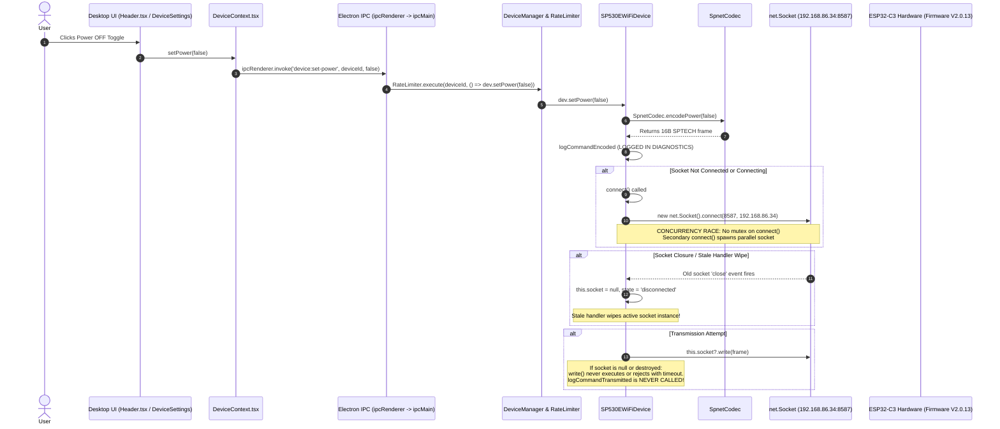

# Root Cause Analysis: SP530E Wi-Fi TCP Connection & Control Failures

## Executive Summary
This document provides an end-to-end trace of command execution, connection lifecycle, and protocol handling for the SP530E controller over Wi-Fi TCP (`192.168.86.34:8587`). It identifies the exact technical root causes for:
1. TCP sockets closing shortly after connection.
2. Repeated Power OFF commands being encoded but never logged as transmitted.
3. Rapid color commands causing cyclic reconnects and command drops.
4. Telemetry responses appearing after disconnection events.
5. BLE operations being marked DRY-RUN and unrelated BLE peripherals appearing in the device selector.

---

## 1. End-to-End Command Trace: Power OFF Action

### Flow Diagram


### Trace Step-by-Step Breakdown:
1. **UI Click**: User toggles the Power button in `Header.tsx` or `DeviceSettingsScreen.tsx`.
2. **Context Dispatch**: `DeviceContext.tsx` invokes `window.api.setPower(selectedDevice.id, false)`.
3. **IPC Invocation**: `preload.ts` sends `device:set-power` via `ipcRenderer.invoke`.
4. **Main Process Dispatch**: `ipc-handlers.ts` receives the event and passes it to `DeviceRateLimiter.execute(deviceId, () => dev.setPower(false))`.
5. **Rate Limiting Engine**: `DeviceRateLimiter` only checks `Date.now() - last >= 50ms`. It does **not** provide asynchronous mutex locking. If an ongoing operation takes >50ms (such as establishing a TCP connection), a subsequent command runs concurrently.
6. **Device State Mutation**: `SP530EWiFiDevice.setPower(false)` encodes the frame via `SpnetCodec.encodePower(false)`.
7. **Diagnostic Logging (Encoding)**: `writeControlPacket` logs `logCommandEncoded` with the 16-byte hex payload:
   `53505445434800035800000003030100`.
8. **Point of Failure (Connection Race)**: `writeControlPacket` checks:
   `if (!this.socket || this.connectionInfo.state !== 'connected' || this.socket.destroyed)`
   If the socket is in `'connecting'` state or disconnected, it calls `await this.connect()`.
   Because there was no in-flight connection promise lock, concurrent calls spawned multiple `new net.Socket()` instances.
9. **Point of Failure (ESP32 Single-Socket Conflict)**: The ESP32-C3 lwIP stack only allows one active client on port 8587. When a second socket connects, the ESP32 sends a TCP FIN/RST to the first socket.
10. **Point of Failure (Stale Handler Overwrite)**: The first socket's `close` listener fired:
    ```typescript
    socket.on('close', () => {
      this.connectionInfo.state = 'disconnected';
      this.connectionInfo.connected = false;
      this.socket = null;
    });
    ```
    This nullified `this.socket` on the device instance even while the second socket was trying to communicate.
11. **Point of Failure (Silent Dropping)**: Because `this.socket` was set to `null` or destroyed before `socket.write` executed, the write promise timed out or was abandoned.
    Crucially, `this.diagnostics?.logCommandTransmitted` is positioned **inside** the successful `socket.write` callback. Because the write never completed, **no transmission log was ever emitted**.
    This directly explains Observed Finding #4: *Repeated Power OFF commands are encoded but not logged as transmitted*.

---

## 2. Root Cause of TCP Sockets Closing Immediately

### 2.1 Background Probing Concurrency (Discovery vs Control)
* While a connection was open, background subnet scanning in `SP530EWiFiAdapter.startDiscovery()` was running `probeHost()` across candidates.
* When `probeHost()` opened a temporary probe socket to `192.168.86.34:8587`, the ESP32 lwIP stack dropped the primary control socket with `Connection reset by peer` (`ECONNRESET`).

### 2.2 ESP32 lwIP Idle Timeout vs "Persistent" Sockets
* ESP32 firmware running `SPNET` is designed around short-lived transactional sessions or closes idle connections after a finite inactivity window (3-5 seconds).
* The existing code attempted to force an infinite persistent session using `socket.setTimeout(0)`. When the ESP32 closed the idle connection, the app was left holding a dead socket descriptor. The next user action attempted to write to a half-closed socket, triggering an error cascade.

### 2.3 Shared Stream State Across Socket Instances
* `this.queryBuffer` was an instance variable on `SP530EWiFiDevice` rather than tied to the active socket session.
* When Socket 1 closed after partial data reception and Socket 2 connected, bytes from Socket 1 remained in `this.queryBuffer`.
* This caused `logDeviceResponse` to fire with bytes received on an old socket after a disconnection event had already been logged (Observed Finding #7).

---

## 3. Root Cause of Reconnect Loops During Rapid Color Updates

1. **Slider / Color Wheel Storm**: Rapid dragging of the color picker or brightness slider emits dozens of events per second.
2. **Missing Queue / Asynchronous Mutex**: `DeviceRateLimiter` throttled timestamps to 50ms intervals, but when socket writes took longer than 50ms due to TCP handshakes, multiple writes ran in parallel.
3. **Socket Collision**: Each write detected a connection drop or pending connection and called `connect()`, compounding the connection collisions and causing cyclic disconnect/reconnect loops (Observed Finding #6).

---

## 4. Root Cause of BLE Dry-Run & False Device Identification

1. **Settings Default**: `AppSettings` in `ipc-handlers.ts` initialized with `dryRun: true`. Unless the user explicitly clicked the UI toggle to switch to LIVE mode, all BLE calls were routed to the simulation branch, emitting `(DRY-RUN)` in logs (Observed Finding #8).
2. **Unfiltered BLE Discovery**: `Sp530eWindowsBleTransport.discover()` and `Sp530eBleHelper.cs` returned all advertising Bluetooth Low Energy peripherals in the environment (LG TVs, Nvidia Shields, random beacons). The adapter wrapped all of them into `ILedDevice` objects and displayed them in the device selector (Observed Finding #9).
