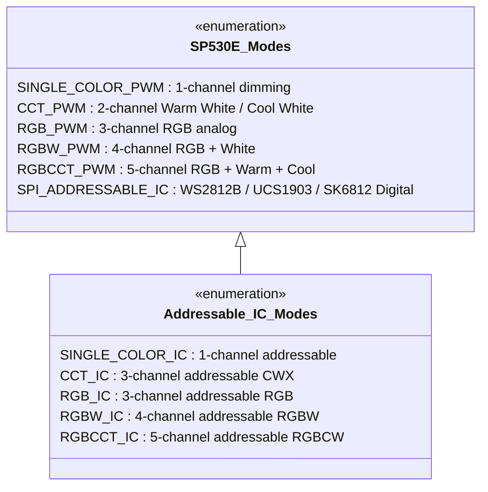

# UI Feature Matrix: BanlanX & Universal LED Controller

## 1. Executive Summary
This document correlates every user interface control and feature observed in the official BanlanX application (via dynamic Android emulator inspection, decompiled Flutter assets in `packages/sp630e/`, and UIAutomator accessibility dumps) against physical SP530E controller hardware capabilities and the target Windows universal controller application.

---

## 2. Feature Comparison Matrix

| Feature Category | UI Control / Widget | Observed Value Domain | SP530E Hardware Capability | Windows Desktop App Target |
| :--- | :--- | :--- | :--- | :--- |
| **Power Control** | Master Power Toggle (`ic_btn_power`) | Boolean (`0x00` = Off, `0x01` = On) | Supported via both BLE and SPNET TCP | Native UI toggle button & keyboard shortcut (`Space`) |
| **Color Brightness** | Horizontal Slider & Presets (`ic_brightness`) | Continuous `0 - 100%` (`0x00 - 0xFF`), Quick presets: 25%, 50%, 75%, 100% | Supported (Byte 2 in Chunk 0x03) | Continuous slider with safety limit (default max 20% during testing) |
| **White Brightness** | Dedicated White Slider (`ic_white_brightness`) | Continuous `0 - 100%` (`0x00 - 0xFF`) | Supported on RGBW / RGBCCT / PWM-CW modes | Independent slider enabled dynamically if device capabilities report `hasWhiteChannel = true` |
| **Color Selection** | Hue / Saturation Ring & Palette Swatches | RGB hex `#000000` - `#FFFFFF` (24-bit RGB) | Supported (WS2812B, UCS1903, SK6812, etc.) | Universal Color Picker (HSV wheel, RGB inputs, Hex input) |
| **Color Temperature** | Dual CCT Slider / Warm-Cold Wheel | 2700K - 6500K (Warm White to Cool White) | Supported when light type is configured as CCT / RGBCCT | CCT Kelvin slider dynamically visible for CCT-capable modes |
| **Custom Swatches** | Add/Remove Swatch (`ic_add_color`, `ic_del_color`) | User-defined RGB presets (up to 16 slots) | Stored locally in app and synced to device DIY memory | Local desktop preset store synced to controller scene slots |
| **Dynamic Effects** | Effect Selector List (`img_dynamic`) | 142 built-in effects (Rainbow, Fire, Meteor, Chase, etc.) | Supported (Mode ID `0x01` - `0x8E` in Dart AOT `setLfxMode`) | Grid/carousel effect selector with real-time effect preview |
| **Effect Speed** | Speed Slider (`ic_speed`) | Continuous `0 - 100` (`0x00 - 0xFF`) | Supported (Byte in Chunk 0x03 `setLfxSpeed`) | Linear slider with step increments |
| **Effect Direction** | Direction Toggle (`ic_effect_dir_left/right`) | Binary (`0x00` = Forward/Left, `0x01` = Reverse/Right) | Supported (`setLfxDir`) | Bi-directional toggle button |
| **Effect Play / Loop** | Pause/Play & Loop (`ic_pause_effect`, `ic_loop_effect`) | Boolean play state; auto-cycle through all effects | Supported (`setOnOffLfx`) | Play/Pause toggle and playlist auto-advance mode |
| **Music Modes** | Audio Source Selector (`img_music`) | 3 Sources: Controller Mic (`inner_mic`), Phone Mic (`mobile_mic`), Music Player | SP530E features onboard electret microphone hardware | Audio source selector supporting PC System Audio (WASAPI) & device mic |
| **Music Visualizers** | Strip vs Matrix Selector (`img_music_strip/matrix`) | 8 Strip Modes (`strip/1-8.png`), 9 Matrix Modes (`matrix/1-9.png`) | Supported (Music modes `0x01` - `0x08`) | Visualizer mode grid with animated waveform icons |
| **Music Sensitivity** | Sensitivity Slider (`ic_sensitivity`) | Continuous `0 - 100` (`0x00 - 0xFF`) | Supported (Microphone gain calibration register) | Real-time gain control slider with VU meter |
| **Music Direction** | Music Flow Toggle (`ic_music_dir`) | Normal, Center-out, Out-to-center | Supported in firmware | Direction selector |
| **LED Chipset** | IC Model Dropdown in Settings (`img_light_type`) | WS2812B, WS2811, UCS1903, SK6812, SM16703, etc. | Supported (Config chunk 0x01, type `0x86` = WS2812B) | Hardware settings dropdown populating controller registers |
| **Color Order** | RGB Sequence Calibration (`ic_reverse_color`) | RGB, RBG, GRB, GBR, BRG, BGR (6 permutations) | Supported (WS2812B default is GRB `0x02`) | Color calibration wizard (click Red -> verify strip turns Red) |
| **Pixel Count** | Number Input (`ic_pixel`) | 1 - 1024 addressable pixels | Supported (Confirmed 60 pixels on user test strip) | Numeric stepper & direct input box |
| **Segmentation** | Segment Manager (`ic_add_segment`, `ic_del_segment`) | Up to 16 multi-pixel segments with independent colors | Supported (Offset + Length per segment in Chunk 0x01) | Multi-segment canvas editor (similar to WLED segment UI) |
| **Favorites / DIY** | DIY Favorites List (`ic_diy_fav_list`) | Custom scenes with color + effect + speed + brightness | Supported in controller NVRAM presets | Local scene manager with cloud/file import & export |
| **Timers & Schedules** | Timer Dialog (`ic_setting_timer`) | Time of day, Repeat Days (Mon-Sun), Target State | Supported by onboard RTC clock | Desktop timer scheduler (syncs system clock to controller) |
| **Power-On State** | Power-on Behavior (`ic_setting_power_on`) | Last State, Default On, Default Off | Supported in firmware EEPROM configuration | Settings dropdown |
| **Keep White Light** | White State Preservation (`ic_setting_keep_white_light`) | Boolean toggle | Supported for RGBCW / RGBCCT setups | Toggle switch |
| **Wi-Fi Config** | Network Settings (`ic_setting_network_config`) | 2.4 GHz SSID & WPA2/WPA3 Password | SP530E 2.4 GHz 802.11b/g/n radio | Wi-Fi provisioning tool (over BLE or AP mode) |
| **Firmware / OTA** | Version & Update (`ic_setting_version`) | Display firmware (e.g. `V2.0.13`) & trigger OTA | Supported via SPNET TCP stream | Firmware status badge & update notifier |

---

## 3. Light Type Architecture (5-in-1 Modality)

As documented in the SP530E Product Manual (`16_manual.png`, `17_sp530e_manual.png`), the SP530E adapts its UI based on the selected wiring output mode:

### 3.1 WS2812B Active Profile (User's Current Setup)
* **Controller Mode**: SPI Addressable IC (`0x86` in configuration Chunk 0x01).
* **Color Order**: GRB (`0x02`).
* **Pixel Length**: 60 LEDs.
* **Available Tabs in UI**:
  1. **Solid Color**: Full RGB 24-bit selection + master brightness.
  2. **Dynamic Effects**: 142 digital chasing/flowing effects with speed and direction.
  3. **Music Modes**: 8 strip audio visualizer patterns driven by onboard mic.
  4. **Multi-Segment**: Division of the 60 pixels into independent sub-segments.
