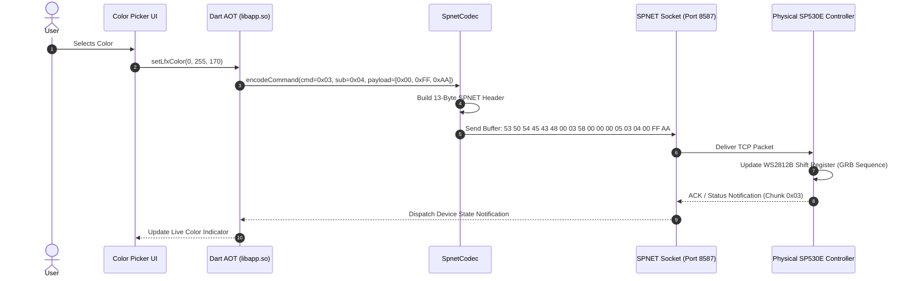
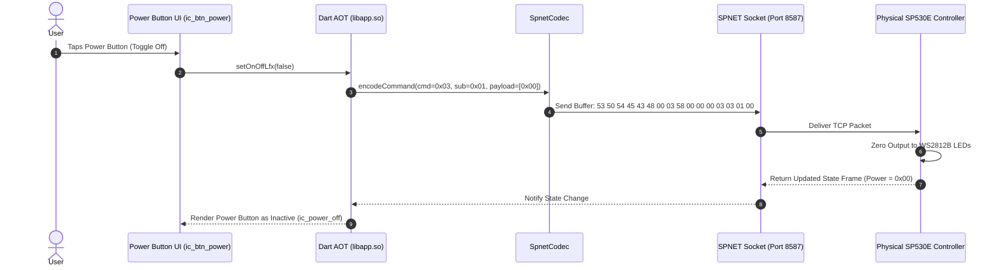

# UI to Protocol Mapping: BanlanX to Hardware Protocol

## 1. Overview
This document maps each UI component and interaction observed in the BanlanX application to the exact native code paths, Dart AOT methods, command opcodes, and byte layouts discovered during reverse engineering and verified against the physical SP530E hardware.

---

## 2. Command Dispatch & Transport Summary

BanlanX uses a dual-transport model:
1. **Bluetooth Low Energy (BLE)**:
   * **GATT Service**: `0000ffe0-0000-1000-8000-00805f9b34fb` (`0xFFE0`)
   * **GATT Characteristic**: `0000ffe1-0000-1000-8000-00805f9b34fb` (`0xFFE1`, Write Without Response + Notify)
   * **Framing**: Direct byte sequence prefixed with magic or command ID.
2. **Local Wi-Fi (`SPNET`)**:
   * **Transport**: TCP Socket on port `8587`.
   * **Framing**: 13-byte fixed header + chunk payload.
   * **Header Structure**:
     `[0..5]` Magic: `SPTECH` (`0x53 0x50 0x54 0x45 0x43 0x48`)
     `[6]` Null: `0x00`
     `[7]` Command ID (e.g., `0x02` = Query, `0x03` = Set State)
     `[8]` Target Key / Sequence (e.g., `0x58` = SP530E session key)
     `[9..10]` Packet Counter / Flags (`0x00 0x00`)
     `[11..12]` Payload Length (uint16 big-endian)

---

## 3. UI-to-Protocol End-to-End Mapping Table

| UI Interaction / Widget | Dart / Java Dispatch Path | Opcode / Cmd ID | Transport & Channel | Outgoing Packet Byte Layout | Verified Evidence Reference |
| :--- | :--- | :--- | :--- | :--- | :--- |
| **Open Device / Refresh** | `App.queryDeviceState()` -> `C2.a.sendQuery()` | Cmd `0x02` | TCP `8587` (SPNET) or BLE `0xFFE1` | `53 50 54 45 43 48 00 02 58 00 00 00 00` (13 bytes) | `protocol/fixtures/sp530e_status_response.bin` (428 bytes returned) |
| **Master Power Toggle** (`ic_btn_power`) | `setOnOffLfx(bool)` -> `sp630e.togglePower()` | Cmd `0x03`, Sub `0x01` | TCP `8587` / BLE `0xFFE1` | Header (13B) + `03 01 [00=Off / 01=On]` | Decoded Chunk 0x03 Byte 0 (`0x01` = Powered ON) |
| **Color Brightness Slider** (`ic_brightness`) | `setLfxBrightness(int)` | Cmd `0x03`, Sub `0x02` | TCP `8587` / BLE `0xFFE1` | Header (13B) + `03 02 [00..FF]` | Decoded Chunk 0x03 Byte 2 (`0xFF` = 100% Brightness) |
| **White Channel Slider** (`ic_white_brightness`) | `setLfxWhiteBrightness(int)` | Cmd `0x03`, Sub `0x03` | TCP `8587` / BLE `0xFFE1` | Header (13B) + `03 03 [00..FF]` | Decoded Chunk 0x03 Byte 3 (`0x00` on WS2812B RGB) |
| **Color Wheel Drag / Palette** (`circular_gradient`) | `setLfxColor(r, g, b)` | Cmd `0x03`, Sub `0x04` | TCP `8587` / BLE `0xFFE1` | Header (13B) + `03 04 [RR] [GG] [BB]` | Decoded Chunk 0x03 Bytes 4-6 (`FF FF FF` = White) |
| **Color Temperature Slider** (`img_white_mode`) | `setLfxCct(kelvin, ratio)` | Cmd `0x03`, Sub `0x05` | TCP `8587` / BLE `0xFFE1` | Header (13B) + `03 05 [Warm: 00..FF] [Cool: 00..FF]` | Supported on CCT PWM & RGBCCT modes |
| **Select Dynamic Effect** (`img_dynamic`) | `setLfxMode(int modeId)` | Cmd `0x03`, Sub `0x06` | TCP `8587` / BLE `0xFFE1` | Header (13B) + `03 06 [ModeId: 01..8E]` | Decoded Chunk 0x03 Byte 1 (`0x01` = Static Color) |
| **Effect Speed Slider** (`ic_speed`) | `setLfxSpeed(int speed)` | Cmd `0x03`, Sub `0x07` | TCP `8587` / BLE `0xFFE1` | Header (13B) + `03 07 [Speed: 00..FF]` | Decoded Chunk 0x03 Byte 7 (`0x80` = 50% Speed) |
| **Effect Direction Toggle** (`ic_effect_dir_left/right`) | `setLfxDir(int dir)` | Cmd `0x03`, Sub `0x08` | TCP `8587` / BLE `0xFFE1` | Header (13B) + `03 08 [00=Left / 01=Right]` | Decoded Chunk 0x03 Byte 8 (`0x00` = Forward) |
| **Dynamic Effect Play/Pause** (`ic_pause_effect`) | `setLfxPlayState(bool isPlaying)` | Cmd `0x03`, Sub `0x09` | TCP `8587` / BLE `0xFFE1` | Header (13B) + `03 09 [00=Pause / 01=Play]` | Dart AOT method `setOnOffLfx` |
| **Music Source Select** (`inner_mic` / `mobile_mic`) | `setMusicSource(int src)` | Cmd `0x04`, Sub `0x01` | TCP `8587` / BLE `0xFFE1` | Header (13B) + `04 01 [00=Device / 01=Phone / 02=Player]` | Android `AudioRecordForegroundService` |
| **Music Visualizer Mode** (`music/strip/1..8`) | `setMusicMode(int modeId)` | Cmd `0x04`, Sub `0x02` | TCP `8587` / BLE `0xFFE1` | Header (13B) + `04 02 [ModeId: 01..08]` | Asset directory `packages/sp630e/assets/images/music/` |
| **Music Sensitivity** (`ic_sensitivity`) | `setMusicSensitivity(int gain)` | Cmd `0x04`, Sub `0x03` | TCP `8587` / BLE `0xFFE1` | Header (13B) + `04 03 [Gain: 00..FF]` | Firmware microphone ADC gain register |
| **Configure IC Chipset** (`img_light_type`) | `setLightType(int icType, int order)` | Cmd `0x01`, Sub `0x01` | TCP `8587` / BLE `0xFFE1` | Header (13B) + `01 01 [Type: 86] [Order: 02]` | Decoded Chunk 0x01 Byte 1 (`0x86` WS2812B, Order `0x02` GRB) |
| **Configure Pixel Count** (`ic_pixel`) | `setLfxPixelCount(int pixels)` | Cmd `0x01`, Sub `0x02` | TCP `8587` / BLE `0xFFE1` | Header (13B) + `01 02 [Pixels High] [Pixels Low]` | Decoded Chunk 0x01 Bytes 2-3 (`0x00 0x3C` = 60 Pixels) |
| **Add / Delete Segment** (`ic_add_segment`) | `setSegments(List<Segment> segs)` | Cmd `0x01`, Sub `0x03` | TCP `8587` / BLE `0xFFE1` | Header (13B) + `01 03 [Count] [StartH StartL LenH LenL]...` | Multi-segment buffer layout in Chunk 0x01 |
| **Rename Device** (`ic_setting_name`) | `setDeviceName(String name)` | Cmd `0x05`, Sub `0x01` | TCP `8587` / BLE `0xFFE1` | Header (13B) + `05 01 [Len] [UTF-8 Bytes]` | Max 20 bytes |
| **Set Power-On State** (`ic_setting_power_on`) | `setPowerOnBehavior(int mode)` | Cmd `0x05`, Sub `0x02` | TCP `8587` / BLE `0xFFE1` | Header (13B) + `05 02 [00=Last / 01=On / 02=Off]` | Stored in EEPROM |
| **Provision Wi-Fi SSID/PWD** (`ic_setting_network_config`) | `configureWiFi(String ssid, String pwd)` | Cmd `0x06`, Sub `0x01` | BLE `0xFFE1` only (AP onboarding) | BLE Frame: `53 50 [Len] [SSID] [Len] [PWD]` | Initiates 802.11b/g/n association |

---

## 4. Sequence Diagrams of Primary User Workflows

### 4.1 Color Change Workflow

### 4.2 Power Toggle Workflow

