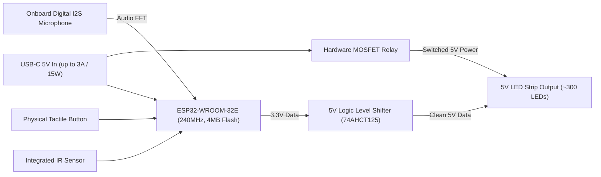

# WLED Platform & QuinLED dig2go Research Dossier

**Author**: Antigravity Lead Engineer  
**Date**: 2026-10-27  
**Target Hardware / Firmware**: WLED (v0.14+) / QuinLED dig2go (ESP32)  
**Status**: Comprehensive Research & Architecture Reference  

---

## 1. Official WLED JSON API Architecture

WLED provides a structured JSON API accessible over HTTP (`GET` and `POST`) and WebSocket (`/ws`) [Source 1, 2]. 

### 1.1 Endpoint Taxonomy
* **`GET /json`**: Returns the complete composite JSON tree combining `state`, `info`, `effects`, and `palettes` [Source 1].
* **`GET /json/state` / `POST /json/state`**: Reads or modifies the active runtime lighting state [Source 1].
* **`GET /json/info`**: Reads device capabilities, hardware status, and network metadata (Read-Only) [Source 1].
* **`GET /json/eff`** (or `/json/effects`): Returns an ordered JSON array of effect names [Source 1].
* **`GET /json/pal`** (or `/json/palettes`): Returns an ordered JSON array of palette names [Source 1].
* **`GET /json/si`**: Efficient combined response returning only `state` and `info` objects without the large effects/palettes lists [Source 1].

---

## 2. Real-Time State Synchronization: HTTP vs. WebSocket

### 2.1 The WebSocket Interface (`/ws`)
Standard WLED builds feature an integrated asynchronous WebSocket server listening at `ws://<device-ip>/ws` [Source 3].

* **Connection Handshake**:
  - Immediately upon WebSocket establishment, the server pushes a full JSON payload containing the current `state` and `info` objects (identical to `/json/si`) [Source 3].
* **Real-Time State Push**:
  - Whenever the lighting state changes—whether triggered via the web UI, physical button, timer, HTTP request, or MQTT—the device broadcasts an updated `state` JSON object to all active WebSocket clients [Source 3]. This eliminates the need for polling.
* **Bi-Directional Command Transmission**:
  - Clients send standard JSON state objects as text frames over the socket (e.g., `{"on": true, "bri": 180}`). The device processes the command and responds with the updated state or `{"success": true}` [Source 3].
* **Heartbeat & Keepalive**:
  - Sending the single character `"p"` returns `"pong"`, providing a lightweight transport heartbeat [Source 3].
* **Security & TLS Boundary**:
  - Standard WLED does not support native TLS (`wss://` is unavailable due to ESP32 crypto overhead) [Source 3]. Desktop clients running in Electron can connect freely to insecure local WebSockets (`ws://`) without browser mixed-content restrictions.

---

## 3. Local Network Discovery

### 3.1 mDNS Service Discovery (`_wled._tcp`)
WLED instances announce themselves automatically on the local network via Multicast DNS (Zeroconf / Bonjour) [Source 4, 5].

* **Service Registration**: `_wled._tcp.local.` on port `80`.
* **mDNS Hostname**: Defaults to `http://wled-<mac-suffix>.local` or a user-defined mDNS name set in Wi-Fi settings [Source 4].
* **TXT Records**: Often include device description, MAC address, and firmware version.
* **Desktop Discovery Implementation**: An mDNS service browser in Node.js / Electron can discover all active WLED controllers on the subnet with zero user configuration.

### 3.2 UDP Real-Time Synchronization
* **WLED Sync Protocol**: Uses UDP port **`21324`** for multi-device sync packets [Source 1, 6].
* **Realtime Streaming**: Accepts raw DDP (Distributed Display Protocol), E1.31 (sACN), Art-Net, and custom TPM2.Net UDP packets on port `4048` / `5568` / `6454` for 60+ FPS live frame streaming [Source 1].

---

## 4. State Representation: Segments, Colors, Effects & Presets

### 4.1 The `state` Schema
```json
{
  "on": true,
  "bri": 128,
  "transition": 7,
  "ps": 1,
  "pl": -1,
  "nl": {
    "on": false,
    "dur": 60,
    "mode": 1,
    "tbri": 0
  },
  "udpn": {
    "send": false,
    "recv": true
  },
  "seg": [
    {
      "id": 0,
      "start": 0,
      "stop": 60,
      "len": 60,
      "grp": 1,
      "spc": 0,
      "of": 0,
      "col": [
        [255, 160, 0],
        [0, 0, 0],
        [0, 0, 0]
      ],
      "fx": 0,
      "sx": 128,
      "ix": 128,
      "pal": 0,
      "c1": 128,
      "c2": 128,
      "c3": 16,
      "sel": true,
      "rev": false,
      "mi": false
    }
  ]
}
```

### 4.2 Segment-Based Architecture
* **Multi-Zone Segmentation**: WLED allows dividing a physical LED strip into discrete virtual segments (`seg` array) [Source 1].
* **Independent Controls**: Each segment independently specifies:
  - `start` / `stop`: Physical pixel index bounds [Source 1].
  - `col`: Array of 3 color slots (Primary, Secondary, Tertiary background color). Supports `[R, G, B]` or `[R, G, B, W]` [Source 1].
  - `fx`: Numeric Effect ID corresponding to the index in `/json/eff` [Source 1, 7].
  - `sx`: Effect Speed (`0`–`255`) [Source 1].
  - `ix`: Effect Intensity / Density (`0`–`255`) [Source 1].
  - `c1`, `c2`, `c3`: Custom effect sliders (e.g., sound sensitivity, frequency threshold) in WLED 0.14+ [Source 1].
  - `pal`: Palette ID corresponding to the index in `/json/pal` [Source 1, 7].
  - `rev`: Reverse effect animation direction [Source 1].
  - `mi`: Mirror segment symmetry [Source 1].

### 4.3 Presets & Playlists
* **Presets (`ps`)**: Presets save the complete multi-segment state, color layout, and effect configuration into `/presets.json` on the ESP32 SPIFFS/LittleFS filesystem [Source 1].
* **Playlists (`pl`)**: Playlists cycle through a list of preset IDs with custom transition durations and shuffle modes [Source 1].

---

## 5. Runtime Capability & Version Detection

A universal client detects device capabilities by inspecting the read-only **`info`** object:

| Key Field | Type | Capability Inferred |
| :--- | :---: | :--- |
| `info.ver` | `string` | Firmware version (e.g., `"0.14.4"`). Used for API version gating [Source 1]. |
| `info.vid` | `integer` | Build timestamp / commit identifier [Source 1]. |
| `info.leds.count` | `integer` | Total physical pixel count configured on the controller [Source 1]. |
| `info.leds.rgbw` | `boolean` | If `true`, strip is RGBW and color arrays accept 4th white channel byte [Source 1]. |
| `info.leds.maxpwr`| `integer` | Hardware current limiter cap (in mA) [Source 1]. |
| `info.leds.maxseg`| `integer` | Maximum virtual segments supported on this hardware (e.g., 16 or 32) [Source 1]. |
| `info.fxcount` | `integer` | Total number of dynamic lighting effects compiled in [Source 1]. |
| `info.palcount` | `integer` | Total number of color gradients/palettes compiled in [Source 1]. |
| `info.arch` | `string` | Architecture (`"esp32"`, `"esp8266"`, etc.) [Source 1]. |
| `info.live` | `boolean` | Indicates if an external streaming source (DDP/E1.31) is currently overriding state [Source 1]. |
| `info.freeheap` | `integer` | Available ESP32 RAM (bytes) for health monitoring [Source 1]. |

---

## 6. QuinLED dig2go Hardware Characteristics

The **QuinLED-Dig2GO** is a specialized, compact, plug-and-play addressable LED controller designed by Quindor (Intermit.Tech) [Source 8, 9].



### 6.1 Hardware Specifications
* **Microcontroller**: Espressif **ESP32-WROOM-32E** (Dual-core Xtensa 32-bit LX6 running at 240 MHz, 4 MB Flash memory, 520 KB SRAM) [Source 9, 10].
* **Dedicated 5V Logic Level Shifter**:
  * Utilizes a high-speed **74AHCT125** level shifter to step up the ESP32's 3.3V GPIO data line to a true **5.0V data signal** [Source 8].
  * Prevents high-frequency signal attenuation, pixel jitter, and color flicker over long lead wires.
* **Onboard Digital I2S Microphone**:
  * Features an integrated digital MEMS microphone wired via I2S directly to the ESP32 [Source 8, 10].
  * Ships pre-flashed with **Sound-Reactive WLED** (WLED-SR), enabling real-time onboard audio FFT spectrum analysis and 20+ specialized music effects [Source 8].
* **Power Architecture & USB-C Input**:
  * **Input**: Standard USB-C 5V DC port [Source 10].
  * **Current Budget**: Rated for continuous loads up to **3.0 Amps** (maximum ~15W total power envelope) [Source 10].
  * **Safe Driving Capacity**: Safely powers strips of approximately **~300 addressable pixels** (e.g., a 5-meter WS2812B strip at 60 LEDs/m at medium-high brightness) [Source 10].
* **Hardware MOSFET Power-Cut Relay**:
  * Features an onboard power MOSFET switch that **physically disconnects 5V V+ power** to the LED strip when turned off in software [Source 10].
  * Eliminates the idle vampire draw (~1mA per pixel) inherent to digital WS2812B/SK6812 chips when dark.
* **Physical Controls & Expansion**:
  * **Tactile Push Button**: Onboard button configured for short press (power toggle), long press (brightness cycle), or double click (preset change) [Source 8].
  * **Infrared (IR) Receiver**: Integrated IR sensor for generic remote control [Source 8].
  * **Expansion Headers**: Two 4-pin female headers exposing 5V, 3.3V, GND, and 4 GPIO lines (supporting I²C sensors or rotary encoders) [Source 9, 10].
* **Dimensions**: Custom injection-molded enclosure measuring 41mm × 57mm × 17mm [Source 10].

---

## 7. Universal Adapter Mapping: SP530E vs. WLED

| Control Concept | SP530E Universal Mapping | WLED / dig2go Universal Mapping |
| :--- | :--- | :--- |
| **Transport** | BLE (`0xFFE0`/`0xFFE1`) / Wi-Fi (`SPNET` TCP 8587) | HTTP REST (`/json`) + WebSocket (`ws://<ip>/ws`) |
| **Power Toggle** | SPNET Command / BLE Byte Write | `{"on": true/false}` |
| **Master Brightness**| `0`–`100%` scale (software mapped) | `0`–`255` scale (`bri` property) |
| **Color Model** | Fixed mode from 12 configurations | Dynamic per-segment color slots (`col` array) |
| **Effect Selection** | 146 proprietary SP patterns by ID | 100+ open-source algorithms by index (`fx`) |
| **Audio Reactivity** | Onboard Mic / Phone Mic (18 modes) | Onboard I2S Digital Mic (WLED-SR audio modes) |
| **Multi-Zone Segments**| Limited strip split | Full arbitrary start/stop segment definitions |
| **Telemetry / Push** | BLE Notifications / SPNET query chunks | Live broadcast on WebSocket (`/ws`) |

---

## 8. Evidence Citations
* **[Source 1]**: Official WLED JSON API Documentation ([https://wled.ge](https://vertexaisearch.cloud.google.com/grounding-api-redirect/AUZIYQH0WZZZ7qyrT9nWQhZakvXsJ169HpBwK6s52l82JW8BZnZMzXfRZudanZ4QqXuk03aQL3ZRwjVCrX1T3HMkXRCpN2wfVt8oDB_rAiUel0n8i32rNXz46XSYVdUm8aU=))
* **[Source 2]**: WLED HTTP API Reference ([https://github.io](https://vertexaisearch.cloud.google.com/grounding-api-redirect/AUZIYQGAs-JCMA7RjNtCfFxuvy86UVNJJC_Eg2TZsXe3DZ4BIKn4KSAozbcTb_F6u_i0zkQ3uT_92quQ-ogFZnLcKv6JNdxe-ID1tZeuFJli3E0b0xgj2HYGJIgj8D5W))
* **[Source 3]**: WLED WebSocket Documentation ([https://wled.ge](https://vertexaisearch.cloud.google.com/grounding-api-redirect/AUZIYQEZdk0-zc6AjiPhO4HGeVWMj5ZRH0izuACrGJCIuQezLqsIsQ_lStLN634FVTzZAe5m2F474D9WLnHr4mDIHD5WpZwdDyZZHX4PedAfIWm6E8m6p2x09ntSM-NSEkikPw==))
* **[Source 4]**: WLED mDNS Discovery Specification ([https://wled.ge](https://vertexaisearch.cloud.google.com/grounding-api-redirect/AUZIYQGKIL-n-9n45q_2Fv_wKxNYoP5Z7lgsSYFG8kI9xCwgxI3BmaKPJBjLn71zQZ4paFrp-eNRrork5ppBesvgMVWNM8mbWcJ3uqfRwHjt7g6O76CYbL1xPwUK))
* **[Source 5]**: WLED Forum Discussion on `_wled._tcp` ([https://discourse.group](https://vertexaisearch.cloud.google.com/grounding-api-redirect/AUZIYQGcTNNtEUKpsWoNN0HGu66UIxVRku6ws0qD9RGCmpVpmdPeCuzPoz-TeJr3RZa9T1lqR1vWYKvPQ78UuyvzAgIXhSWDKmrSTVpmwYIM2ieJAY2LavaSmDJnBEq-bEV7HAe2L2d23IIwFF4CJuGW3S6CJ3GDrSfaEewPEevSy6oomKuaZ4A=))
* **[Source 6]**: WLED Network Sync Documentation ([https://wled.ge](https://vertexaisearch.cloud.google.com/grounding-api-redirect/AUZIYQFeteULRsnXPGj8p5QxbSPY-mdxyIEYUaGjY6Llt8bxkUaiW4lfyzdfF6VOwX-I9iEpTCxtQz2758sjCQ5Jt0zt8RHzNh61CV9y5MQKAddkTQqukWRqLoInLekfywLdWg==))
* **[Source 7]**: WLED Effects & Palettes Reference Guide ([https://wled.ge](https://vertexaisearch.cloud.google.com/grounding-api-redirect/AUZIYQHZCVgTHhv-tJaWU4gu51nYGAP6T9NxDAYNh4pHaVRuGgGxTQzSGTDLN3EAL-5fOI6-y5CnWVbNMjN1etAuqvXIFY3LTMAutq3VgK0U84ttamz-LvqcwRElJsYi))
* **[Source 8]**: QuinLED-Dig2GO Official Hardware Specification ([https://quinled.info](https://vertexaisearch.cloud.google.com/grounding-api-redirect/AUZIYQGpqDabTq7XNcODlIQ3wAsY1fcKJC9I2L4He6_ldai87JMylwNKFRagOIr3LI7LBWCtD4yLW7Xz44VjGd7dBsQ5xYrsYAvsl25PJXbs7gcetc9SOG4Dmz2dDV0=))
* **[Source 9]**: DrZzs QuinLED dig2go Architecture Overview ([https://drzzs.com](https://vertexaisearch.cloud.google.com/grounding-api-redirect/AUZIYQGyUIjc6dhyHemNJJIUanZg1jYLIckB1FUG8YDKEfzne29hZzqZVKOVa9xyzx-dNi0D75untghde4H7uCyQb--TUzm6KJPfx4uEgrHB_BR0XtrI5g8RAUB7))
* **[Source 10]**: Dig2GO Official Hardware Technical Guide ([https://dig2go.info](https://vertexaisearch.cloud.google.com/grounding-api-redirect/AUZIYQFTuX0rXuIsIj4Bpav3HEqyepTGXkzj7mdeBpIzDn107n-UlnRlAemggHPNg6cqB_R88TnitCXNUgTgPhyTxBEnT-aTlSdt0WHz3Q==))
